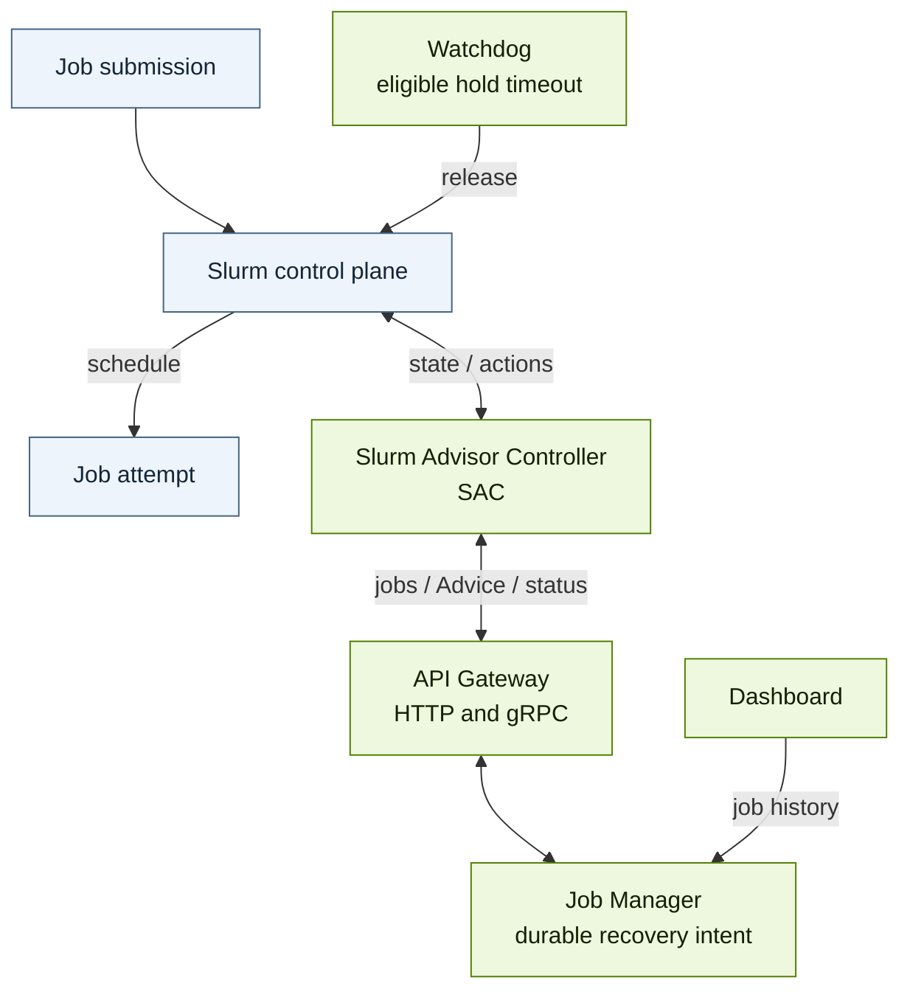
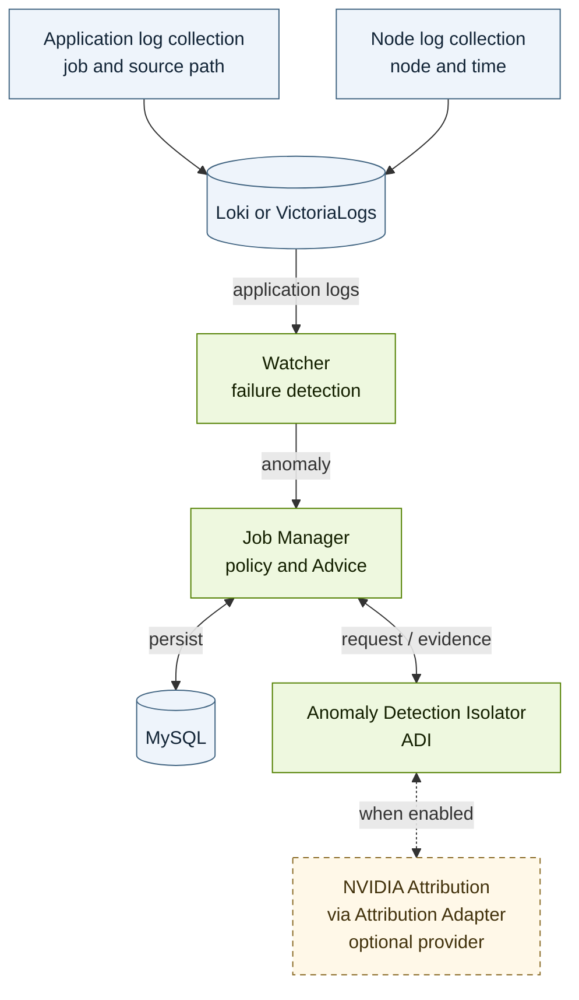

# NVIDIA Recovery architecture

NVIDIA Recovery answers a workload-level question: **when a training run stops
making useful progress, what should happen next?** A scheduler knows where a
job runs and whether it has exited. Application telemetry can reveal a crash,
a hang, or a sustained slowdown. Neither observation by itself completes the
work of deciding, restarting, and checking that recovery happened.

This overview is for operators and developers who know how a job reaches their
scheduler. Read it to follow one recovery from submission through the next
attempt; no running installation is required.

## Why the system is divided this way

Imagine job `12345` failing during an overnight training run. The failure must
remain attached to the execution that produced it, even after a new attempt
starts. The recovery decision must survive a service restart. And the component
issuing scheduler commands must check what has already happened before acting
again. These needs explain the main boundaries:

| Question | Component | Why it is separate |
| --- | --- | --- |
| Has training failed or stopped progressing? | **Watcher** reads configured application signals. | Detection recognizes symptoms; it does not issue scheduler commands. |
| What do we know about this execution, and what should happen next? | **Job Manager** stores attempts, evaluates policy, and persists Advice. | Recovery retains history and a decision that another service can resume. |
| What evidence explains the failure? | **Anomaly Detection Isolator (ADI)** processes evidence, optionally using NVIDIA Attribution. | A recovery decision can proceed without a definitive root-cause diagnosis. |
| How do we carry out the decision here? | **Slurm Advisor Controller (SAC)** observes Slurm, publishes state, and applies eligible actions. | Scheduler-specific tactics and safety checks stay with the scheduler integration. |

The API expresses that separation: a **Job** records an observed attempt;
**Advice** records the desired outcome for that attempt; reconciliation status
records whether the scheduler was later observed to satisfy the decision.
API Gateway exposes the contract between the backend and SAC. Slurm and
Slurm-on-Kubernetes through Slinky use the same adapter.

## Components and responsibilities

### Scheduler control and visibility

### Detection and recovery decisions

Watcher detects crash signatures, missing expected progress, and sustained
throughput degradation from application streams. These observations identify
symptoms, not necessarily causes: a communication timeout, for example, does
not by itself distinguish an application problem from a hardware fault.
Straggler-triggered recovery must be enabled separately from detection.

Application logs and node logs have different identities. A node's system logs
belong to that node and time window; optional attribution can correlate them
with the job's allocation.
They are not relabeled as job output. The two collection boxes can be handled
by the same collector deployment.

Watcher signals and the Job Manager–ADI request/result flow travel through
RabbitMQ. The diagram shows the logical flow rather than individual queues.

Job Manager owns the durable recovery intent. ADI returns attribution evidence
and applies isolation policy; Job Manager combines the result with the job's
recovery policy and persists Advice. The optional private NVIDIA Attribution
provider is disabled by default. ADI remains in the core recovery path: with
the provider disabled or unavailable, the fail-open path returns no provider
attributions, allowing policy-driven recovery without inventing a diagnosis.

## Follow one failed attempt

Consider illustrative Slurm job `12345` in workflow `training-run`. Its first
execution is attempt `0`; requeue creates attempt `1` under the same scheduler
job ID.

1. **Submit and discover.** The user submits the job with recovery policy. SAC
   reads Slurm job and accounting state, resolves the effective operating mode,
   and publishes each tracked attempt through API Gateway. Job Manager stores
   the observed state and policy.
2. **Preserve a failed job.** When an eligible job fails, SAC can move it into
   requeue hold before Advice exists. This keeps the job available while the
   recovery decision is being prepared. This action still requires action
   authorization and eligible recovery policy.
3. **Detect the failure.** Watcher reports a matching application-log anomaly.
   Job Manager can also generate a crash anomaly from failed scheduler state:
   immediately when the job explicitly disables log-based crash detection, or
   through the configured delayed fallback when a recent failed attempt has
   no actionable recovery anomaly. Hang and straggler detection still need
   application signals.
4. **Process evidence.** Job Manager sends the anomaly to ADI through RabbitMQ.
   ADI processes the available attribution result and returns evidence. An
   enabled Attribution provider can add diagnosis from application and node
   telemetry.
5. **Persist intent.** For a recoverable failure within its requeue policy,
   Job Manager persists `RESTARTED` Advice for source attempt `0`, with node
   exclusions when supported by the evidence and policy. Policy can instead
   require termination, for example when the requeue limit is reached.
6. **Reconcile.** SAC reads active Advice and fresh Slurm state. After checking
   ownership, routing, operating mode, and attempt applicability, it advances
   the restart through requeue hold, any required placement changes, and
   release. Already-satisfied steps are skipped.
7. **Observe the result.** A later snapshot must show successor attempt `1`
   unheld with the required constraints before SAC reports the Advice
   generation as `CONVERGED`. Permanent inapplicability becomes `ABANDONED`;
   a transient failure stays eligible for another reconciliation.

Node exclusions change **where this job may run**. They do not repair hardware
or establish that a node is healthy. Likewise, the independent watchdog's
timeout release prevents eligible recovery holds from lasting indefinitely;
it never opens the initial held attempt of a DAG child.

## Recovery and application progress

A successful scheduler command means the command was accepted. Advice
convergence means the requested scheduler state was subsequently observed.
Neither establishes that training loaded a checkpoint or finished its work.

After Slurm starts attempt `1`, the application must find and load its own
checkpoint from durable storage. Application logs or metrics establish resumed
progress. A later successful scheduler completion and the expected application
output establish completion of the workload. Keep these milestones separate
when validating an installation or investigating an incident.

## Continue reading

- [Jobs, attempts, and workflows](docs/concepts/jobs-and-workflows.md) explains
  which identity connects the failure to the next attempt.
- [Advice](docs/concepts/advice.md) explains desired state, generation, and
  terminal reconciliation status with a concrete API example.
- [Scheduler integration](docs/concepts/scheduler-integration.md) explains
  adapter responsibilities and the Slurm action boundary.
- [SAC architecture](docs/architecture/slurm-advisor-controller.md) and
  [log-query architecture](docs/architecture/log-query-backends.md) provide
  implementation detail.

To run the recovery path, continue with [Getting started](docs/getting-started.md).
