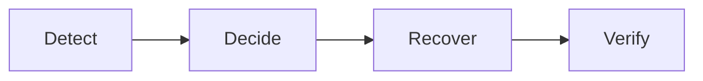

# NVIDIA Recovery

[Build status](https://github.com/dsx-ai-factory/NVIDIA-Recovery/actions/workflows/pull-request-and-main.yml)
· [Apache-2.0 license](LICENSE)

NVIDIA Recovery detects crashes, hangs, and stragglers in distributed AI
training and coordinates automated recovery. This saves operators and researchers
from having to watch and debug jobs manually around the clock.

## Why NVIDIA Recovery?

In distributed training, one failed process, stalled collective, or slow worker
can interrupt progress across an entire GPU allocation. As clusters and runs
grow, so does exposure to failures.

When this happens, recovery becomes an investigation: is the problem in the
training code, the framework, communication libraries, or hardware? Is it safe to
retry? Should the next attempt avoid a node? Overnight, that investigation may
not even start until someone sees the stalled run.

Because of the potential scale of these failure scenarios, recovery must be both
timely and correct. Lengthy manual investigations can delay recovery.

NVIDIA Recovery automates this process by:

1. Detecting drops in forward progress and job failures.
2. Using NVIDIA Attribution to diagnose anomalies and guide the
   recovery response needed to restore forward progress.
3. Integrating with the job system and scheduler to restart the workload and
   exclude nodes if needed.

This automated workload-recovery loop runs on infrastructure you operate and
requires only minor modifications to job submission, allowing researchers to
continue using their scheduler and checkpoint-capable training scripts.

## What it detects

- **Crashes:** failed executions and recognized application errors, including
  PyTorch/NCCL, CUDA, and GPU interconnect failure signatures.
- **Hangs:** jobs that stop emitting expected progress or report recognized
  communication or application hang symptoms.
- **Stragglers:** sustained drops in reported training throughput relative to
  the recent baseline—not just jobs that have exited.

Log-based detection requires configured patterns and progress signals; the failed
scheduler state also provides a crash-detection fallback. Straggler-triggered
recovery is opt-in. NVIDIA Attribution adds deeper diagnosis across
application, system software, and hardware. The recovery loop works without it;
recognizing a symptom is not the same as proving its root cause.

## How it works

NVIDIA Recovery records a failed [attempt](docs/concepts/jobs-and-workflows.md)
and decides whether policy allows another try. It persists that decision as
[Advice](docs/concepts/advice.md): "restart this attempt, with these placement
constraints." The [scheduler integration](docs/concepts/scheduler-integration.md)
performs the necessary actions and checks their results. The new execution then
loads its checkpoint using the application's own restart logic.

This separation makes the decision inspectable and lets the controller resume
unfinished recovery work from the current scheduler state. Restarting an allocation,
restoring training progress, and completing training are distinct milestones.
Refer to the [architecture and full job lifecycle](ARCHITECTURE.md) for more details.

## Start here

| Your goal | Guide |
| --- | --- |
| See recovery on a disposable local stack; no physical GPU needed | [Get started locally](docs/getting-started.md) |
| Submit and follow jobs on an installed service | [Run jobs](docs/users/running-jobs.md) |
| Build images, install, validate, and operate your deployment | [Deploy and operate](docs/operators/installation.md) |
| Set up the repository and make a change | [Develop and contribute](docs/development/getting-started.md) |
| Understand components and recovery boundaries | [Architecture](ARCHITECTURE.md) |

Find more detailed guides and references in the [documentation map](docs/README.md),
or start with the [FAQ](docs/faq.md).

## Current support

NVIDIA Recovery is **experimental and not ready for production use**. APIs,
configuration, and behavior may change. It supports NVIDIA GPU clusters from
Ampere through Hopper to Blackwell, with Slurm or Slurm-on-Kubernetes through
Slinky. Kubernetes-native workload recovery is not currently implemented.

The project distributes source and Helm charts; operators build their own
images. NVIDIA Attribution is enabled by default; its source is not yet publicly
fetchable. See [Attribution prerequisites and degraded OFF mode](docs/public-api/optional-attribution.md).
The local demo explicitly selects OFF and requires no private provider credentials.
NVIDIA Recovery manages workloads, not hardware repair or checkpoint storage.
Refer to the [Support](SUPPORT.md) and [Releases](RELEASE.md) sections for
the current boundaries.

## For developers

Start with the [developer guide](docs/development/getting-started.md) and
[focused testing guide](docs/development/testing.md). External contributions are
welcome; [Contributing](CONTRIBUTING.md) explains review, DCO sign-off, and CI approval.

For help, see [Support](SUPPORT.md). Report vulnerabilities privately through
[Security](SECURITY.md). See [Governance](GOVERNANCE.md), [Maintainers](MAINTAINERS.md),
and the [Code of Conduct](CODE_OF_CONDUCT.md) for how the project works.

## License

NVIDIA Recovery is licensed under [Apache-2.0](LICENSE), except where a file
or component carries its own license. Upstream license grants, copyright
notices, and attribution remain in effect; the repository license does not
replace them. The [Fern stylesheet](fern/main.css) is NVIDIA-owned source
released under Apache-2.0.

The repository contains the following 10 nested license files:

| Directory or component | License | License file |
| --- | --- | --- |
| [Vendored code-simplifier skill](agent-capabilities/vendor/code-simplifier/) | Apache-2.0 | [LICENSE](agent-capabilities/vendor/code-simplifier/LICENSE) |
| [Vendored Context7 skill](agent-capabilities/vendor/context7/) | MIT | [LICENSE](agent-capabilities/vendor/context7/LICENSE) |
| [Vendored feature-dev skill](agent-capabilities/vendor/feature-dev/) | Apache-2.0 | [LICENSE](agent-capabilities/vendor/feature-dev/LICENSE) |
| [Slurm Advisor Controller chart](deploy/helm/slurm-advisor-controller/) | Apache-2.0 | [LICENSE](deploy/helm/slurm-advisor-controller/LICENSE) |
| [NVIDIA Recovery umbrella chart](deploy/helm/nvidia-recovery/) | Apache-2.0 | [LICENSE](deploy/helm/nvidia-recovery/LICENSE) |
| [Alloy license material](deploy/helm/nvidia-recovery/licenses/) | Apache-2.0 | [alloy.LICENSE](deploy/helm/nvidia-recovery/licenses/alloy.LICENSE) |
| [Bitnami charts license material](deploy/helm/nvidia-recovery/licenses/) | Apache-2.0 | [bitnami-charts.LICENSE](deploy/helm/nvidia-recovery/licenses/bitnami-charts.LICENSE) |
| [Grafana charts license material](deploy/helm/nvidia-recovery/licenses/) | Apache-2.0 | [grafana-charts.LICENSE](deploy/helm/nvidia-recovery/licenses/grafana-charts.LICENSE) |
| [MinIO license material](deploy/helm/nvidia-recovery/licenses/) | GNU AGPL v3 | [minio.LICENSE](deploy/helm/nvidia-recovery/licenses/minio.LICENSE) |
| [OpenTelemetry charts license material](deploy/helm/nvidia-recovery/licenses/) | Apache-2.0 | [opentelemetry-charts.LICENSE](deploy/helm/nvidia-recovery/licenses/opentelemetry-charts.LICENSE) |

The two chart-level `LICENSE` files are copies of the root Apache-2.0 license
so each chart carries the license when packaged or distributed independently.
The umbrella chart also retains upstream license material in its
[licenses directory](deploy/helm/nvidia-recovery/licenses/), including the
[MinIO notice](deploy/helm/nvidia-recovery/licenses/minio.NOTICE). Chart licenses do not
relicense the applications or container images deployed by those charts;
those components retain their own licenses and notices.

## Contributors

Thanks to everyone who contributes to NVIDIA Recovery.

[View contributors](https://github.com/dsx-ai-factory/NVIDIA-Recovery/graphs/contributors)
