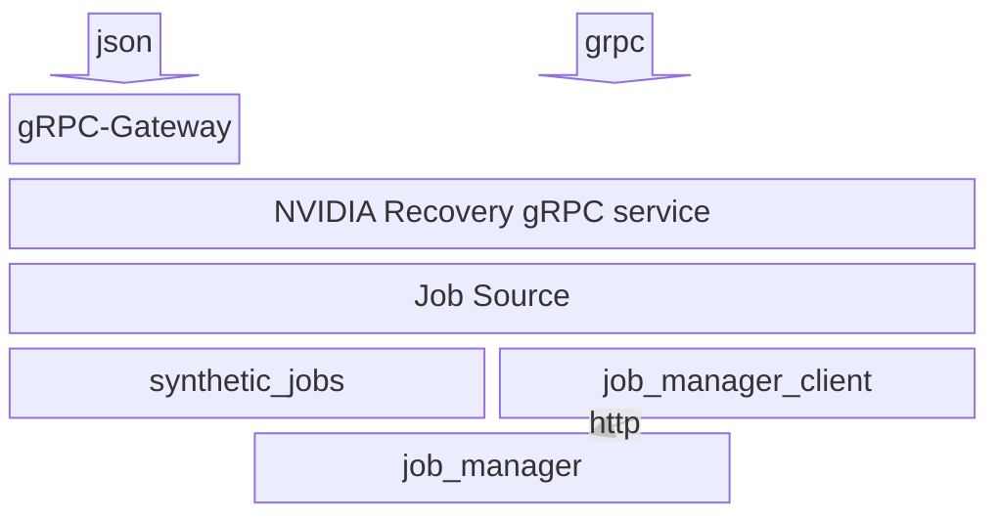
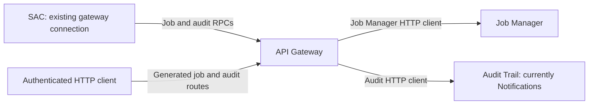

# api-gateway architecture

The api-gateway exists as a stable scheduler-agnostic interface to internal NVIDIA Recovery services.

It delegates workload and recovery operations to Job Manager and audit ingestion
to Audit Trail, currently deployed as Notifications. Neither downstream service
needs ingress for scheduler adapters to use these APIs.

## Overview

The gateway exposes typed gRPC services and generates HTTP routes and OpenAPI
from their protobuf definitions. `AuditService.CreateAuditEvents` follows the
same path as `HeimdallService.CreateOrUpdateJob`: a shared service registration,
a generated HTTP handler, and an adapter backed by a generated downstream HTTP
client. Audit has no internal-only registration or OpenAPI exclusion.

The Go package layout follows Job Manager as well:

| Responsibility | Job Manager | Audit Trail |
| --- | --- | --- |
| RPC server | `internal/server/heimdall.go` | `internal/server/audit.go` |
| Source interface and protobuf translation | `internal/server/job` | `internal/server/audit` |
| Downstream HTTP client | `internal/jobmanager` | `internal/audit` |

The audit RPC server receives an `audit.AuditSource`, just as the `HeimdallService` RPC
server receives a `job.JobSource`. `AuditClientSource` owns protobuf translation
and error mapping; the downstream audit client uses the generated Notifications
HTTP models and has no protobuf dependency.

Both services use the listener's existing authentication. Public ingress routes
to the public gRPC or HTTP port with OIDC/JWT authentication; the existing
internal gRPC listener can use Kubernetes ServiceAccount authentication. SAC
uses the same connection and credentials for jobs and audit events. The current
SAC client supports plaintext gRPC and projected ServiceAccount tokens; using a
TLS ingress requires corresponding client transport support.

`POST /v1/audit/events` is relative to the configured public URL prefix. Like
Job Manager's generated routes, it uses protobuf JSON and gRPC-to-HTTP status
mapping. Downstream HTTP 202 acceptance becomes gRPC success or gateway HTTP
200, including partial acceptance; overload becomes `ResourceExhausted` or HTTP
429. Unix microseconds, producer idempotency keys, and partial rejection counts
survive translation. Audit Trail owns validation, idempotency, and storage. Audit ingestion is always
available through the existing gateway authentication boundary.

The gateway-facing downstream setting is `HEIMDALL_AUDIT_ENDPOINT` / Helm
`audit.endpoint`. Its default retains the Notifications Service DNS name until
the planned service rename. The generated downstream request builder and wire
models remain sourced from `notifications/openapi.yaml`.

Audit ingestion uses the generated HTTP handlers on both existing HTTP listeners,
with the same authentication and URL-prefix configuration as Job Manager. The
backing service's query, notification, preference, and operational routes are
not exposed through this gateway.

The job source can provide either synthetic data or Job Manager-backed data. This is primarily to facilitate testing and development.

