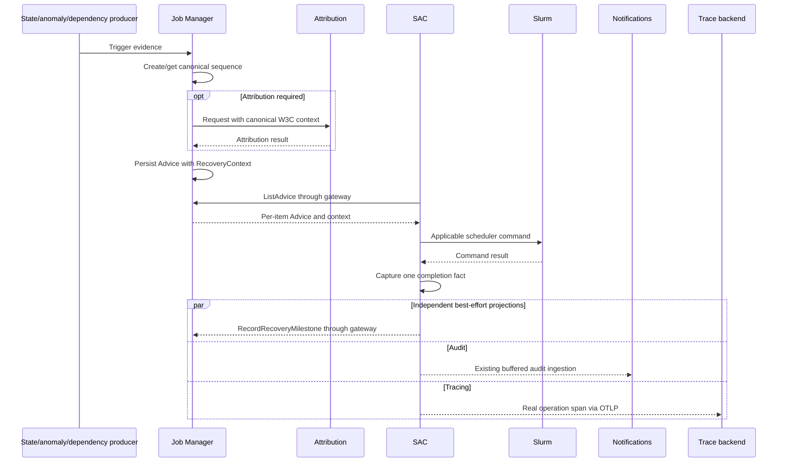

# Recovery Observability Revision: Design Study and Stack Changes

Date: 2026-10-07

This study describes the accepted design in
[ADR 0048](../decisions/0048-start-recovery-traces-in-backend-and-share-observations.md),
approved through [PR #245](https://github.com/NVIDIA/NVIDIA-Recovery/pull/245)
and maintainer confirmation on 2026-10-08. Implementation remains pending in
the stack below; this is not a description of deployed tracing.

## Findings

The study used `main` at `4a4dadfbe87e`, merged PRs and their review discussions,
and the current heads of the pending tracing stack.

| Evidence | Finding | Design effect |
| --- | --- | --- |
| [Original ADR, PR #7](https://github.com/NVIDIA/NVIDIA-Recovery/pull/7) | Accepted recovery identity, real spans, successful-release endpoint, and compatibility-first rollout. Discussion explicitly anticipated sharing operational data with audit. | Preserve measurement semantics; replace the obsolete initiating path. |
| [Merged persistence, PR #20](https://github.com/NVIDIA/NVIDIA-Recovery/pull/20) | Stores sequences/milestones, selects one immutable natural-key winner, and completes from explicit adapter intent. Review rejected scheduler semantics in shared storage. | Keep the storage model and scheduler-neutral completion ownership. |
| [Advice-only recovery, PR #214](https://github.com/NVIDIA/NVIDIA-Recovery/pull/214) | SAC can wait for restart Advice; eager recovery remains gated. Standalone default is off, but Helm default is still on. | Revised tracing targets eager-off operation; chart-default retirement is separate work. |
| [Audit ADR, PR #17](https://github.com/NVIDIA/NVIDIA-Recovery/pull/17) and [ADR 0038](../decisions/0038-catalog-audit-event-payloads-and-identifiers.md) | Audit covers more than recovery; common source data was discussed, and Notifications owns best-effort persistence. | Share facts without merging storage responsibilities. ADR 0017 remains proposed; ADR 0038 adopts the relevant boundary. |
| [Fanout proposal, ADR 0053](../decisions/0053-fanout-audit-and-recovery-trace.md), [PR #39](https://github.com/NVIDIA/NVIDIA-Recovery/pull/39), `5b4f7456ba67` | Historical proposal explicitly accepts separate outgoing milestone and audit calls. | Adopt the fanout principle and refine it with shared observations and independent delivery in ADR 0048. |
| [Scoped observability proposal, ADR 0032](../decisions/0032-unify-slurm-controller-observability-behind-scoped-lifecycles.md), [PR #75](https://github.com/NVIDIA/NVIDIA-Recovery/pull/75), `0d72e977a510` | Historical proposal unifies controller scopes for per-sync metrics, recovery telemetry, and audit. | ADR 0048 supersedes it with a narrow recovery lifecycle; the broader proposal is retired. |

The fanout proposal from PR #39 is retained and indexed as
[ADR 0053](../decisions/0053-fanout-audit-and-recovery-trace.md), replacing its
retired proposal number 0018. ADR 0048 supersedes it, carrying its fanout
principle forward; ADR 0053 is retained as historical rationale.

The scoped observability proposal from PR #75 is retained in the canonical
collection as [ADR 0032](../decisions/0032-unify-slurm-controller-observability-behind-scoped-lifecycles.md).
ADR 0048 supersedes it with the recovery-lifecycle subset; the broader
controller-wide proposal is retired.

### What phase one actually provides

The merged [models](../../recovery_libs/recovery_libs/schema/job_manager/models.py),
[records](../../recovery_libs/recovery_libs/storage/dataclass.py), and
[storage](../../recovery_libs/recovery_libs/storage/mysql_storage.py) provide:

- A unique `(scheduler_system, scheduler_scope, job_id, source_attempt_index,
  operation)` identity and immutable canonical W3C context/trigger evidence.
- Independent sequence rows, allowing correlation before Advice exists, and
  canonical Advice context selected from its operation and scheduler metadata.
- Milestone uniqueness by `(sequence_id, idempotency_key)`, rejection of
  conflicting duplicate payloads, and serialized first-completion updates.
- UTC microsecond timestamps and nullable Advice correlation fields, through
  merged Alembic revision `000000000003`.

These remain needed with backend-only creators: repeated messages, simultaneous
state/anomaly processing, concurrent backend workers, and restart versus DAG
operations still require arbitration. Keep pre-Advice storage and optional
context; neither is exclusively eager-path machinery. No phase-one table drop,
historical migration rewrite, or natural-key change is needed.

The phase-one `BeginOrGetRecoverySequenceRequest/Response` models can be
replaced at the public boundary by lookup-only models; creation input becomes
backend-internal. Its production REST/RPC operation is pending in #27, not
deployed by #20. Normal SAC consumers already have per-item Advice context and
need no additional lookup.

### Overlapping instrumentation and a pending timing defect

SAC's current
[observation boundary](../../slurm-advisor-controller/internal/reconcile/recovery_auditable_observations.go)
names application and action outcomes and captures command completion. The
[audit observer](../../slurm-advisor-controller/internal/audit/recovery/observer.go)
projects those facts into typed events; it intentionally suppresses repeated
poll skips and separately emits accepted terminal-generation events.

At #28 head `17d74cb59846`, `runAdviceRecoverySchedulerAction` nests
`runRecoverySchedulerAction` inside `runAdviceSchedulerAction`. The inner
function records command-return time and then synchronously calls
`RecordRecoveryMilestone`; the outer audit wrapper timestamps the inner
function's return. A slow reporting RPC therefore shifts the audit timestamp
past actual command completion. It also generates a different occurrence
key for each projection. Replace those nested wrappers with a single
execution boundary and shared immutable result.

| Operation | Existing audit surface | Trace/milestone reuse |
| --- | --- | --- |
| Watcher detection / job observation | `anomaly_detected`, `job_attempt_observed`, `job_attempt_updated` | Link producer evidence to the backend root when available; not every operational event needs a sequence. |
| Attribution | `attribution_request_forwarded`, `attribution_response_received` | Share request identity, timing, and result with real attribution spans; propagate context before dispatch. |
| Backend Advice transition | `advice_created`, `advice_updated`, `advice_unpublished` | Share the committed transition and recovery identity; retain snapshot and suppression rules. |
| Actual SAC command | `advice_scheduler_action_completed` | One command-return timestamp/outcome/occurrence feeds action span, audit, and milestone. |
| SAC application result | `advice_application_applied`, `advice_application_evaluated`, `advice_application_failed` | Share classification with reconcile spans; planned actions are not command completions. |
| Fresh-state convergence / abandonment | `advice_reconciliation_converged`, `advice_reconciliation_abandoned` | Reuse generation-scoped outcomes; do not extend command latency or add a terminal policy. |
| Watchdog / retained eager commands | `watchdog_release_completed`, `job_auto_requeue_hold_completed` | Preserve audit independently; these paths need no backend lookup or sequence creation. |

## Revised flow

There is no public begin call or wait for remote reporting before the next
command. The diagram's command occurrence repeats for hold, constraints, and
release as applicable. Failed attempts emit error facts with
`completes_sequence=false`; a later actual attempt gets a new ID. Successful
release supplies completion; later reconciliation status separately records
observed convergence.

### How much sharing is worthwhile

| Option | Benefit | Cost / conclusion |
| --- | --- | --- |
| Shared observations, independent projections | Reuses identity, lifecycle, timestamps, classification, and command wrapper; retains stores/transport. | Recommended. Delivery can diverge; coverage metrics remain per destination. |
| Audit ingestion also updates Job Manager completion | One producer submission. | Requires forwarding, retries, partial-acceptance semantics, and independence from logging-only audit configuration. Defer. |
| Job Manager milestones produce all audit events | One recovery write path. | Milestones lack operational events, snapshots, skips, and errors; expands Job Manager into a general audit service. Reject. |
| Exported spans produce audit history | Fewer application call sites. | Couples product history to sampling, exporters, attribute limits, and retention. Reject, as in ADR 0017. |
| Full PR #75 controller lifecycle | Eventually unifies all controller instrumentation. | Changes unrelated metrics and source/worker lifecycles. Adopt only the recovery subset for this stack. |

Share local logic and existing gateway clients, retaining separate persistence
calls. An all-or-nothing queue would let an audit outage consume milestone
capacity or retry already-accepted audit work. Each destination needs its own
bounded delivery policy. Existing audit buffers provide a useful pattern, but
their event selection and acceptance contract do not define milestone delivery.

### Identity and UI

| Identifier | Meaning | Rule |
| --- | --- | --- |
| `heimdall_job_id` | Canonical workload attempt | Required audit query key; never replace with sequence ID. |
| `recovery_sequence_id` | One scoped attempt and operation | Optional explicit audit payload field; `recovery.sequence.id` on spans. |
| `trace_id`, `span_id` | Trace and actual operation span | Optional UI correlation, derived from validated context. |
| Producer occurrence UUIDv4 | One actual operation/event | Reuse across action audit and milestone; preserve on delivery retries. |
| Internal audit UUIDv7 | Notifications row / cursor identity | Remains owned by audit storage. |
| Legacy `correlation_uuid` | Sequence ID or Advice-ID fallback | Preserve compatibility; never assume it is a sequence or trace ID. |

The current [audit query](../../notifications/notifications/routers/audit_events.py)
is workload-attempt-oriented, without a dedicated recovery-sequence filter.
Its opaque payload can carry optional correlation without a new audit table
or index. Producer schemas and the release-coupled payload catalog still need
updates. Advice snapshots already carry `recovery_context`; action events need
their own immutable correlation so the UI does not query mutable Advice for
every historical row.

Initially link correlated events to an operator-configured trace viewer from
the existing audit table/timeline. Keep events visible when context is missing,
sampling drops traces, or retention expires. Server-side sequence filtering
can follow when needed; it is not part of today's query contract. Open
whole-job audit work in [PR #234](https://github.com/NVIDIA/NVIDIA-Recovery/pull/234)
and [PR #235](https://github.com/NVIDIA/NVIDIA-Recovery/pull/235) is separate
from sequence correlation and is not yet merged.

## Changes to the implementation stack

This is an edit plan for existing PRs, not a request to merge them as-is.

| PR / inspected head | Required revision |
| --- | --- |
| [#20](https://github.com/NVIDIA/NVIDIA-Recovery/pull/20), merged | Retain persistence, concurrency winner, timestamps, migrations, and storage concurrency/idempotency tests. Creation input types can become internal as #27 replaces the public boundary. |
| [#27](https://github.com/NVIDIA/NVIDIA-Recovery/pull/27), `72238bb7ef15` | Replace public begin-or-get routes/protos/generated clients with read-only lookup. Keep internal creation before attribution and DAG/termination Advice, including current audited upsert paths. Rebase on current backend ownership and retired relay changes. Derive identical scheduler scope for creation and context attachment. Guard all correlation failures, including job-record reads, without suppressing Advice. Reuse committed transition data. Validate successful completion intent without interpreting Slurm names. |
| [#28](https://github.com/NVIDIA/NVIDIA-Recovery/pull/28), `17d74cb59846` | Remove `beginFailedJobRecovery`, `direct_failed_job` plumbing, eager-specific spans/reports, and associated creation calls/tests. Replace nested wrappers with one lifecycle/result and an independent bounded milestone reporter. Retain audit selection/destinations. Use current generation-scoped Advice status classification instead of the branch's separate `adviceSkipIsTerminal` table. |
| [#29](https://github.com/NVIDIA/NVIDIA-Recovery/pull/29), `0a8cfcc5773c` | Exercise advice-only recovery and DAG paths through production interfaces. Assert context across Python/Go, shared action timestamps/identity across audit and milestone, and separate later convergence. Cover reporting failure isolation in component tests. Remove eager-root expectations and retain source-specific attribution evidence. |
| [#30](https://github.com/NVIDIA/NVIDIA-Recovery/pull/30), `3ab6344594aa` | Rebase collector/deployment work on main. Keep bounded outcome/latency metrics and trace queries; remove eager-coverage assumptions. Explain reporting gaps and unknown command timing. Add audit-to-trace UI work explicitly or in a focused dependent PR: the inspected branch changes Grafana/collector assets, not workload audit UI. Validate operator-selected destinations and current global OTLP configuration. |

No extra migration is needed merely to remove SAC creation or share action
facts. Later persisted generation-to-sequence linkage, query indexes, or
expanded sequence status require additive migrations and review, not silent
changes to phase one's schema.

### Focused behavioral confirmation for implementation

- Concurrent backend triggers converge on one sequence; lookup misses have no
  storage side effects; separate operations remain distinct.
- The trigger precedes attribution and Advice publication. State failures and
  anomaly recovery both retain end-to-end coverage.
- One scheduler invocation yields identical completion time and occurrence in
  audit/milestone despite slow or failed reporting. Delivery retries retain
  identity; actual command retries receive new IDs.
- Logging-only audit, failed trace export, queue overflow, and milestone
  timeout independently preserve command count, arguments, cancellation, and
  result. A projection never depends on another projection's success.
- Failed/planned actions cannot complete restart measurement. Already-satisfied
  state or terminal-generation status cannot synthesize missing command time.
  Duplicates cannot move completion or add metric samples; distinct late
  completions preserve first-accepted semantics.
- DAG release is correlated but excluded from restart SLO. Constraint-only
  Advice and watchdog auditing work without recovery context.
- Audit queries preserve old events and optional new correlation. UI trace
  navigation uses explicit IDs and handles unavailable traces.

Use existing storage integration tests, component tests, controller harness,
and production-interface E2E lanes. Avoid source-text or dashboard-JSON snapshots
as substitutes for behavioral proof. Human review remains required for
scheduler execution and public contracts; documentation checks do not validate
those runtime changes.
