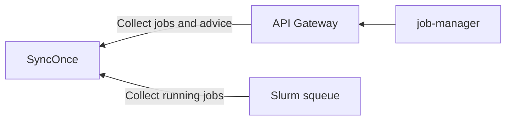
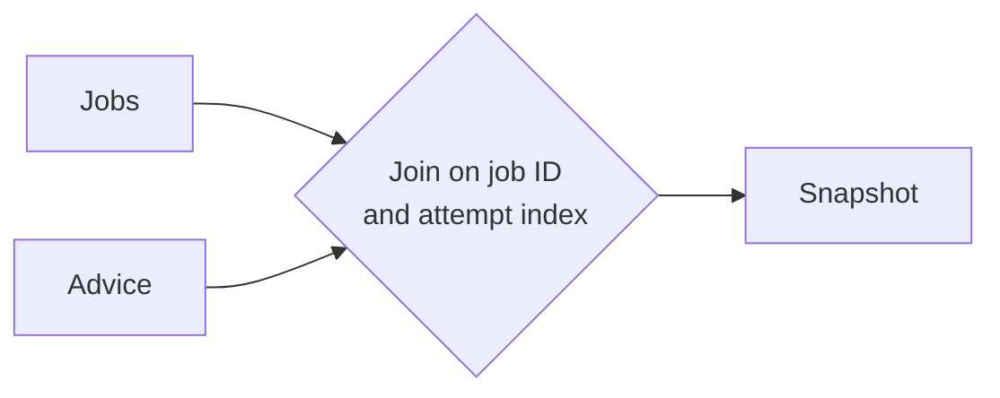
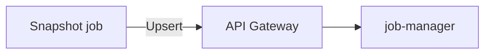
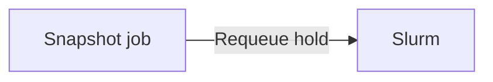
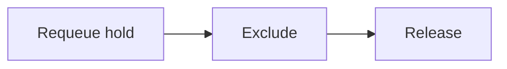

# Slurm Advisor Controller Architecture

The slurm advisor controller is responsible for performing actions on behalf of NVIDIA Recovery based on Advice NVIDIA Recovery provides.

As the name suggests it uses controller & reconciler approach. The process of remedation is intentionally stateless. Advice is intentionally abstract in terms of scheduler specific remedation tactics. This abstracts schedulers from NVIDIA Recovery allowing for supporting different types of job systems but also allows the scheduler specific controller more control over the exact tactics it can employ when remediating.

## What the controller does

The Slurm advisor controller is a standalone, level-triggered Go process between Slurm and NVIDIA Recovery's `HeimdallService` API. It operates on a single reconciler loop that polls both slurm metadata, NVIDIA Recovery data and reconciles them.

### Collects snapshot data

Job metadata is collected from Slurm `squeue --json` each tick. Job discovery
is bootstrapped once per process from `job-manager` via the `HeimdallService`
provided by the `api-gateway`, retrying until successful. After bootstrap
succeeds, subsequent ticks use fresh Slurm data, Advice, and the local
seen-attempt set instead of querying Job Manager jobs again.

Bootstrap requests `GetJobs(completed_jobs=false)`: Job Manager selects
non-final attempts in SQL before count and pagination. Finished attempts with
unresolved Advice are discovered independently through
`ListAdvice(only_active=true)`, without a bootstrap age cutoff. An attempt still
non-final in the backend remains discoverable even if it finished in Slurm
during controller downtime.

When eager requeue is enabled, SAC also paginates
`GetJobs(reconciliation_eligible_jobs=true, end_time_from=cutoff)`. Job Manager
applies its existing eligibility predicate and `end_time >= cutoff` in SQL
before count and pagination. This preserves recent failure candidates without
reading lifetime failure history. The cutoff is fixed for all pages of that
bootstrap read and uses the persisted job end time, not submission or last
update time. Final attempts with unknown end time do not match this read;
unresolved Advice and fresh Slurm observations remain independent sources.

`SLURM_ADVISOR_BOOTSTRAP_FAILURE_LOOKBACK` (Helm:
`controller.bootstrapFailureLookback`) defaults to `30m` and must be positive.
It affects only eager bootstrap failure discovery, not active attempts,
unresolved Advice, or already-seen work. Change it with a controller restart.
Both job queries must succeed before bootstrap completes.

All gateway replicas must support `completed_jobs` and `end_time_from` before
the updated SAC is deployed; older gateways can ignore the new protobuf fields
and return unbounded history. Roll back SAC before rolling back the gateway.
See [ADR 0047](../decisions/0047-bound-sac-bootstrap-discovery.md).

Job Manager discovery runs once at startup. Before retaining a returned attempt
or scheduling accounting, SAC matches its stored `recovery_config.environment`
against the controller environment using the same literal rules as Slurm APS
admission. Missing configuration, absent/null environments, and empty strings
are undeclared: `prod` and `unspecified` accept these candidates, while named
environments such as `nvr-test` reject them. This also applies to legacy records
whose environment was not preserved; SAC does not substitute the publishing
backend's `scheduler_metadata.environment`.

This filter only controls backend discovery. Fresh `squeue` jobs and owned
Advice remain independent discovery sources, and fresh Slurm admission still
guards publication and actions. Advice rejected by existing ownership checks
remains visible in skip reporting but does not contribute an accounting key.
See [ADR 0037](../decisions/0037-filter-sac-bootstrap-by-aps-environment.md).

SAC also supports `SLURM_ADVISOR_USER_ALLOWLIST=alice,bob` (Helm:
`controller.userAllowlist: [alice, bob]`). **This is a temporary control solely
for the initial internal cluster rollout. It will be deprecated soon and may
be removed without notice; it is not a long-term supported interface.**

The list selects actions, not monitoring. For an otherwise admitted job with
no explicit mode, a listed submitting username selects `act` and an unlisted
or unknown username selects `observe`, regardless of the controller default.
An explicit valid job mode takes precedence over the list: an unlisted user's
`mode: act` job can receive actions, and a listed user's `mode: observe` or
`mode: ignore` job cannot. Invalid explicit modes select `observe`. Scheduler
acknowledgement remains an independent hard ceiling.

An unset or empty list leaves the existing default-mode behavior in effect.
Configuration trims surrounding whitespace from names, ignores empty entries,
and removes duplicate names; a nonempty value containing only separators is
rejected. Username matching is exact and case-sensitive, with no wildcards or
UID/mail-recipient fallback. Restart or redeploy to apply a changed list.
The intended rollout uses default `observe`; SAC logs a bootstrap warning when
default `act` and a nonempty list are configured together, but accepts that
configuration.

Username selection never rejects bootstrap candidates, Advice ownership,
seen-state retention, accounting, or enrichment. All otherwise admitted jobs
whose effective mode is not `ignore` remain monitored and published, including
unlisted users. Fresh `squeue.user_name` and `sacct.user` provide the submitting
identity used for action selection; stored backend usernames do not gate
discovery. Environment/onboarding admission and partition safeguards retain
their existing behavior.

SAC and the watchdog share the same job-mode resolver and username matcher.
Helm supplies `controller.mode`, `controller.acknowledgeSchedulerActions`, and
`controller.userAllowlist` to both processes. For standalone/systemd deployments,
keep `SLURM_WATCHDOG_JOB_DEFAULT_MODE`,
`SLURM_WATCHDOG_JOB_ACTIONS_ACKNOWLEDGED`, and `SLURM_WATCHDOG_USER_ALLOWLIST`
aligned with `SLURM_ADVISOR_MODE`,
`SLURM_ADVISOR_ACKNOWLEDGE_SCHEDULER_ACTIONS`, and
`SLURM_ADVISOR_USER_ALLOWLIST`, respectively; restart both services after
changes. The watchdog job-policy defaults are `observe`, `false`, and an empty
list. Its own process mode, acknowledgement, environment, partition, timeout,
and DAG safeguards remain additional constraints. See
[ADR 0042](../decisions/0042-align-sac-and-watchdog-job-action-policy.md).

Advice is also collected via the same `HeimdallService`. SAC requests
`only_active` Advice. Routing selects one authoritative reconciler for each
Advice generation. Job Manager applies visibility, reconciliation-path, and
current-generation terminal-status predicates before count and pagination. It
does not reproduce SAC's expiration, scheduler-state, or attempt-applicability
rules. Active-query page tokens bind any explicit `created_after` filter; SAC
does not use `created_after` to select reconciliation work.

### Retired on-demand job updates

Job Manager still scans non-final attempts for stale updates, logs the affected
attempts, and reports the stale-job count. Its optional stale cleanup policy
is unchanged. Stale detection does not publish refresh requests or inspect
RabbitMQ queue lengths. SAC owns scheduler observations through the discovery
and reconciliation paths above; see
[ADR 0039](../decisions/0039-retire-on-demand-job-updates.md).

For an existing deployment:

1. Remove the old `on_demand_job_update_request_enabled`,
   `on_demand_job_update_queue_length_cutoff`, and
   `on_demand_job_update_request_routing_key` overrides and the
   `on_demand_job_update_request_queue` publisher binding from custom values
   and raw service configuration.
2. Stop old processes using the shared job-record ORM before applying shared
   storage revision `000000000005`; old binaries still reference the removed
   columns. Deploy updated shared-library consumers together. The migration
   removes only refresh bookkeeping, preserving job records and timestamps.
   Human review is required before applying this migration.
3. Removing a declaration does not delete an existing durable RabbitMQ queue.
   After old publishers have stopped, inspect the retired queue's bindings,
   consumer count, and backlog. An operator can then delete the unused queue
   and obsolete messages through the normal approved broker change process.
   Do not remove the job-update or anomaly queues used by retained behavior.

For rollback, stop updated database users and downgrade revision
`000000000005` before starting old binaries. The columns are recreated as
nullable; deleted request history is not restored. Keep refresh publishing
disabled in old binaries so the unconsumed backlog cannot recur.

### Retired job anomaly relay

Job Manager persists Watcher and generated END/CRASH anomalies and sends the
existing `AttributionRequest` directly to ADI. This includes eligible running
and completing attempts, not just final jobs. The direct ADI feature gates,
straggler policy, and atomic emission claim remain unchanged. Terminal Advice
and recovery notifications no longer depend on the retired ARM relay switch.
Watcher ingestion and missing-job redelivery remain supported.

Remove `job_anomaly_message_relay_enabled`, `job_anomaly_relay_routing_key`,
`job_end_event_message_delay_secs`, `publisher_exchange`, and
`publisher_queue_routing_key_mapping` from custom JM configuration and chart
values. Preserve `job_end_event_generation_enabled` and the
`adi_attribution_request_*` settings. The dedicated ADI publisher no longer
requires the obsolete generic publisher exchange to be configured.

After stopping old producers, inspect the old `job_anomaly_relay_queue`, its
bindings, and any delay/dead-letter queues declared for it. Operators should
retire those unused queues and backlog through the approved broker change
process. Removing chart declarations does not delete existing broker objects.
Preserve Watcher redelivery queues and ADI request/result exchanges and queues.

The relay counter `aps_job_manager_anomaly_message_relayed_total` is removed.
Generated-anomaly metrics replace the former ARM publication counters:
`aps_job_manager_end_anomaly_generated_total` and
`aps_job_manager_crash_anomaly_for_failed_jobs_generated_total`. Shipped
dashboards use these names; custom dashboards and alerts need the same update.
See [ADR 0040](../decisions/0040-retire-job-anomaly-relay.md).

### Retired ARM attribution result queue

ADI publishes normal fast and slow attribution results to
`isolator_completed_exchange` (default `aie_eventbus_exchange`) using
`anomaly.isolation.bad_nodes`. Job Manager owns the durable queue and binding
through `anomaly_attribution_queue`, `anomaly_isolator_exchange`, and
`anomaly_attribution_routing_key`. The Helm defaults and standalone Job Manager
configuration use this route to deliver results to `anomaly_attribution_queue`
for attribution persistence
and recovery Advice.

ADI no longer declares or binds `queue_bad_nodes_isolation`. Remove
`isolator_completed_queue` from ADI Helm overrides and environment/configuration
files; preserve `isolator_completed_exchange`. Explicit request `output_queue`
destinations still declare and bind their custom queue with the queue name as
routing key. The similarly named shared schema package remains used by Advice
code and does not create RabbitMQ queues.

On a fresh broker, start Job Manager and verify its result queue and binding
exist before ADI publishes results. On an existing broker, verify that JM's
queue uses the same virtual host, exchange, and result routing key as ADI.
Deploy updated ADI publishers, then inspect the old queue's bindings, consumer
count, and backlog. Once it is confirmed unused, retire the legacy queue and
its binding through the approved broker change process. Until the old binding
is removed, RabbitMQ will still send it a copy of each matching result.
Deleting only its messages does not stop the buildup. Preserve the exchange
and Job Manager's live result queue.

See [ADR 0041](../decisions/0041-retire-arm-attribution-result-queue.md).

### Compile snapshot

Advice may not yet exist or the job may no longer exist in `squeue`, so the
controller constructs a union of potential job identifiers (job plus attempt
index). Attempts requiring fresh accounting data are grouped by unique job ID.
The controller issues one single-job `sacct` request per ID through a bounded
worker pool, then assembles the results in job-ID and attempt order. This forms
one logical snapshot of Advice and current job execution status without
overlapping complete reconciliation ticks.

Accounting failures are isolated to each single-job request. Successfully
decoded responses remain available for job publication even if another command
or response fails or the accounting phase reaches its deadline. The tick still
reports the joined errors. Missing results do not establish that a job is gone:
unresolved seen attempts remain eligible for the next tick, while successfully
published completed attempts leave the seen set normally. With eager recovery
enabled, failed attempts that still need a recovery decision remain retained;
otherwise Advice provides
subsequent recovery discovery.

An incomplete accounting snapshot permits publication of fresh observations,
but failed-job recovery and Advice reconciliation wait for a complete tick.
This preserves the existing scheduler-action safety boundary. Cancellation of
the overall tick stops further work. See
[ADR 0046](../decisions/0046-preserve-successful-slurm-accounting-results.md).

### Resolve per-job operating mode

Each current Slurm record is assigned one effective mode before reconciliation.
The controller combines its operator-selected default with a valid,
object-valued `APS` or `HEIMDALL` comment and an optional `mode` field. The
field accepts `ignore`, `observe`, or `act` using the existing APS casing and
whitespace behavior: JSON whitespace is accepted, field names are
case-sensitive, values are lowercased, and value whitespace is not trimmed.

For valid onboarded jobs, resolve mode in this order:

| Job mode | Username list | Effective mode before acknowledgement |
| --- | --- | --- |
| Explicit `ignore`, `observe`, or `act` | Any | Explicit job mode |
| Explicit invalid mode | Any | `observe` |
| Absent | Configured, username listed | `act` |
| Absent | Configured, username unlisted or unknown | `observe` |
| Absent | Empty/unset | Controller default |

The list also overrides a default of `ignore` for jobs without an explicit
mode. Missing or invalid onboarding comments never authorize actions.
`SLURM_ADVISOR_ACKNOWLEDGE_SCHEDULER_ACTIONS` is the independent action
ceiling: when false, any resolved `act` becomes `observe`, whether selected by
job mode, username, or the default.

### Post job metadata

Jobs resolved to `observe` or `act` are upserted into NVIDIA Recovery through a bounded
worker pool that is independent of Slurm accounting concurrency. Jobs resolved
to `ignore` are not upserted and are removed from the controller's local seen
set. Active attempts are marked seen before publication; finalized attempts are
removed from the seen set only after their upsert succeeds.

Slurm-owned dashboard metadata—including cluster, partition, user, command,
state reason, node count, and aggregate CPU, GPU, and memory—is carried in
`scheduler_metadata`. Job Manager validates and projects those values into its
typed `SlurmJobExecutionRecord` fields; API Gateway transports them opaquely so
the Advisor contract remains scheduler-neutral. Accounting updates omit values
that Slurm does not report reliably, preserving richer metadata previously
observed through `squeue`. See [ADR 0028](../decisions/0028-project-slurm-job-fields-from-scheduler-metadata.md).

### Wait for recovery Advice

With eager recovery disabled, a failure observation is published to Job Manager
without creating another Slurm attempt. SAC waits for applicable `RESTARTED` Advice before
issuing `requeuehold`. Job Manager evaluates retry limits and checkpoint
progress stopping through the existing Advice model. `TERMINATED` Advice for
an already-failed source converges without creating or canceling a successor.
Early failure observation during COMPLETING remains enabled.

After a final accounting update is successfully published, SAC removes the
attempt from its local seen set. Failed publications remain discoverable for
retry; later Advice independently rediscovers the source for accounting and
reconciliation. Active COMPLETING attempts remain seen until final accounting
has been published. Recovery can be lost if Advice arrives after Slurm purges
the scheduler record; there is no automatic eager-requeue fallback.

For rollout or rollback, `SLURM_ADVISOR_ENABLE_EAGER_REQUEUE=true` (Helm:
`controller.enableEagerRequeue: true`) restores direct failed-job requeue before
Advice. The standalone process and Helm chart both default to false for
Advice-only recovery. Changes take effect on process restart. The eager path
retains its mutation-retry bookkeeping and telemetry, and all
existing action-mode, acknowledgement, environment, and partition gates.
Enabling it also restores the race with Job Manager's retry/checkpoint stop
decisions; it does not add policy evaluation to SAC. The watchdog's release
rules are unchanged. See
[ADR 0045](../decisions/0045-require-advice-before-slurm-requeue.md).

### Bound eager recovery retries

These bounds apply when eager recovery is enabled.

Known permanent command rejections, including a job ID already purged by
Slurm, end this attempt's recovery immediately. Transient and unknown failures
receive three total command attempts, with 250 ms and 500 ms local waits while
the failed-job phase has time. `SLURM_ADVISOR_FAILED_JOB_RECOVERY_TIMEOUT`
(default `30s`) bounds that phase. When the budget expires, unfinished attempts
stay seen and keep their consumed retry counts for the next tick. A command
interrupted by this deadline consumes one attempt; interruption during backoff
does not consume an additional attempt. The next tick rotates past the last
attempted job so later jobs get a turn, using fresh scheduler observations.
After exhaustion SAC marks the attempt processed and removes its terminal
accounting work from `SeenJobs`. Active `COMPLETING` jobs remain seen until
their final accounting read, without repeating recovery. Caller cancellation
interrupts retries without marking recovery processed. Each command result is
audited, and final failure is returned once at the tick boundary.

Give-up is process-local: restart/bootstrap can retry the same failed attempt.
Durable Job Manager status and recovery-aborted audit reporting are deferred
until recovery converges on Advice. See [ADR 0043](../decisions/0043-bound-failed-job-requeue-retries.md)
and [ADR 0044](../decisions/0044-budget-failed-job-recovery-phase.md).

### Reconcile each job and advice pair

#### Restart advice

Advice for restart reconciles through the following steps. Requeue hold is
skipped when Slurm reports the source attempt as requeued or the next attempt
is observed; a held source attempt alone does not satisfy this step. Constraint
updates and release are skipped when fresh state already satisfies them.

A configurable delay follows the advice-driven requeue hold to give Slurm time
to process the command. Updating node exclusions does not insert a sleep.

### Terminate advice

Advice for termination checks if the job is already in a terminal state. If not it issues an `scancel` command.
For a DAG abort, Job Manager writes exact-attempt `TERMINATED` Advice for the
held child and every deeper descendant while marking their dependency gates
terminal. The controller consumes those durable recommendations through this
same path on its next normal reconciliation tick; Job Manager does not call
Slurm directly. `TERMINATED` Advice is exempt from the generic advice age
limit: the controller continues reconciling the exact attempt until fresh
Slurm state reports a terminal state. Ownership, routing, mode, and attempt
checks continue to apply before any scheduler mutation.

### Release advice

`ADVICE_STATE_RELEASED` targets one exact `(job_id, attempt_index)`. When that
attempt is pending and held, the controller issues `scontrol release`; pending
unheld, running, requeued, and final attempts already satisfy the advice. A
future or older attempt is skipped, and release advice does not carry node
constraints. Freshly observed convergence is reported to Job Manager, which
records the exact Advice generation as `CONVERGED`. `only_active` then excludes
that generation. A later operator
re-hold is preserved instead of being reopened by historical Advice; overriding
it would require new producer intent in a new generation.

### Record terminal Advice outcomes

SAC checks environment admission and Advice ownership before reporting a
generation-scoped status. Expiration is handled before scheduler-record lookup,
partition, mode, and attempt checks; other outcomes follow those checks.
`CONVERGED` means fresh Slurm
state satisfies the recommendation. `ABANDONED` is restricted to monotonic
evidence that the generation cannot converge, such as expiry, a stale attempt,
a final target, or an already-running successor that cannot safely receive
restart constraints. For unexpired Advice, missing scheduler records, future
attempts, and transient action failures remain non-terminal. Observe mode can
report terminal outcomes from observed state, but does not mutate Slurm.

A successful Slurm command is not convergence evidence. SAC waits for a later
snapshot to observe the desired state before publishing terminal status. Status
writes are idempotent by Advice ID and generation. Advice responses contain one
optional reconciliation status only when it matches the current generation;
older generation history is not transferred to consumers. Changing action-
affecting intent, including routing metadata, advances the Advice generation
and reopens work without deleting persisted prior status history. Job ingestion
does not scan Advice,
Job Manager does not run a scheduler-aware background reconciler, and Advice
list reads do not write status. SAC's periodic reconciliation loop alone
materializes scheduler-derived outcomes such as `STALE_ATTEMPT`.

Persisted terminal status bounds a SAC cold start to the unresolved working set
from before shutdown plus Advice
generations created while SAC was unavailable. Durable Advice that became stale
during the outage can appear once; SAC classifies it and later `only_active`
polls exclude it. Expiration is a generation-scoped SAC policy based on
`desired_state_changed_at`, with `created_at` as a mixed-version fallback. SAC
records expired generations as `ABANDONED: ADVICE_EXPIRED`; Job Manager does
not maintain a parallel age setting or silently hide them.

Deploy this contract in dependency order: apply the additive Job Manager
migration and deploy Job Manager first, then deploy API Gateway with the new
filter and status RPC, and only then deploy SAC configured to request
`only_active`. Historical queries remain compatible throughout; an older SAC
continues to omit the optional filter and does not write status.

### Watchdog release behavior

The watchdog reconstructs eligibility from each fresh `squeue` record rather
than from a per-job flag. Before creating process-local state, it admits the
job's valid APS/HEIMDALL `environment` through its configured environment
pattern and requires `act` from the shared job-mode policy before creating
held timers. Literal patterns preserve the controller's legacy-compatible routing
semantics; `*` matches zero or more characters, including `/`, while every
other character remains literal. Matching is exact and case-sensitive without
trimming. A valid APS/HEIMDALL comment with non-empty `dag_dependencies`
identifies a DAG child. The attempt index comes from Slurm's restart count.

| Observed job | Watchdog behavior |
| --- | --- |
| DAG child, attempt 0, pending and held | Never release; only exact `RELEASED(0)` advice may open the DAG gate. |
| DAG child, attempt 1 or later, pending and held | Start a timer and release after the watchdog timeout. |
| Managed non-DAG job, any attempt, pending and held | Start a timer and release after the watchdog timeout. |
| Managed job, pending and unheld or running | Clear any held timer; do not mutate the job. |
| Job policy resolves to `ignore` or `observe`, or job is environment-mismatched, unmanaged, filtered, or final | Do not retain state or mutate the job. |

The held timer is process-local. Restarting the watchdog reconstructs which
jobs are eligible from Slurm, but restarts the timeout rather than releasing a
job immediately from stale local state. Changing a job comment so its
environment no longer matches, changing its partition to one outside the
allowlist, or resolving its effective job mode to something other than `act`
deletes its timer; becoming eligible again starts a fresh timeout. The watchdog's
process-wide observe mode reports release decisions for jobs allowed by the
shared job policy without calling Slurm. Its process-wide `act` mode and its own
scheduler-action acknowledgement are both required to release a job.

## Safety and reliability

## Safety

Jobs are acted on only when their effective mode is `act`. That requires a
valid APS/HEIMDALL comment, an effective request for action, and the independent
operator acknowledgement. Observe mode computes planned outcomes but never
calls a Slurm mutator; ignore mode neither tracks nor plans the job. Missing,
malformed, unrelated, and invalid-mode comments never authorize action.

## Reliability

### Crash safety and reconciler approach

One of the reason a stateless reconciler approach is used is to ensure the controller is crash safe. A reconcilation should be safely interruptable at any point. Once the controller is healthy again the next loop will pickup where the last reconcilation attempt left off.

### Timeouts

To prevent a hung Advice operation from starving later work, the controller
applies two deadlines within Advice reconciliation:

1. Advice loop: Bounds the Advice reconciliation phase.
2. Advice item: Bounds reconciliation of an individual Advice item.

These deadlines do not cover the entire `SyncOnce` tick.

Targeted Slurm accounting also has a phase-level timeout and a maximum number
of unique job IDs per tick. Each `sacct` command retains its own execution
timeout.

Because the reconcilers are crash safe they are also cancel safe.

## Current limitations

1. Repeated failures for a reconcilation are not backed off and there is no circuit breaker for jobs.
2. Fast repolling. The architecture is purposefully simplistic. A more sophisticated channel and even based system could have dynamiclly scheduled targeted polling.
3. Not all slurm features are covered. Currently only simple non-array jobs are supported.
