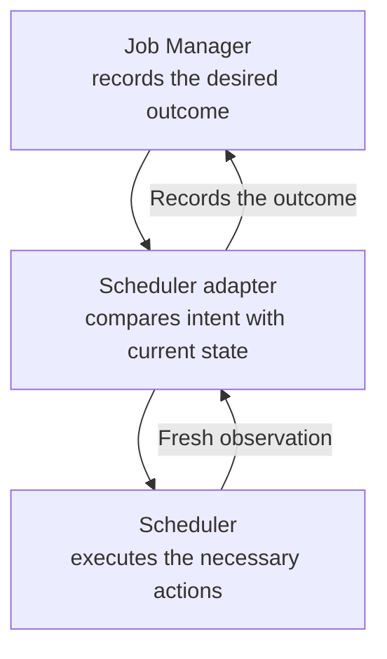

# Advice: durable recovery intent

A failed training process tells you that something went wrong. It does not tell
you whether restarting is appropriate, which nodes to avoid, or whether a
previous restart actually happened. **Advice is NVIDIA Recovery's recorded
decision about what should happen next to one execution attempt.**

This guide is for operators and API consumers familiar with
[jobs and attempts](jobs-and-workflows.md). No running service is required. It
explains how to read a recovery decision and why the API separates that decision
from the actions used to carry it out.

## From a symptom to a decision

Imagine job `12345`, attempt `0`, fails overnight. The training log reports an
error, and available diagnostic evidence implicates node `gpu-001`. Recovery
policy permits another attempt. These are related facts, but they answer
different questions:

| Question | In this example |
| --- | --- |
| What happened? | The training process failed: a symptom. |
| Why might it have happened? | Evidence implicates a node; attribution helps explain the failure. |
| What should happen next? | Restart this attempt, excluding that node: Advice. |
| Did it happen? | A fresh scheduler observation shows the successor unheld with the exclusion: reconciliation status. |

Job Manager combines the signal, available attribution evidence, and recovery
policy into Advice. A confirmed hardware cause is not required for every
restart: exclusions depend on evidence and policy, and private Attribution is
optional. An observed error, a suspected cause, and permission to act are not
interchangeable.

## Why persist a decision?

A restart is more than a single command. In Slurm it can involve holding a
requeued job, changing its placement, and releasing it. The controller might
restart between those steps, or the scheduler might accept a command before
its new state becomes visible.

Advice preserves the intended outcome across those interruptions. The adapter
compares it with current scheduler state, performs the remaining work, and
checks again. This repeated comparison is called **reconciliation**. It can
resume from what actually happened rather than blindly replaying a sequence of
commands.



The same record lets an operator inspect the decision even after it stops
being active work. Advice is therefore both an execution contract and a record
of recovery intent, not merely a notification that an error occurred.

## Desired state and target

Advice names one immutable target: the scheduler job and attempt index, with
NVIDIA Recovery's stable attempt ID. Its recommendation expresses the desired
outcome and any placement constraints. Attached issues provide evidence behind
the decision; evidence alone does not authorize an action.

| Desired state | Meaning |
| --- | --- |
| `RESTARTED` | Recover the source attempt by making its successor eligible to run. |
| `TERMINATED` | End this exact attempt. |
| `RELEASED` | Make this exact attempt scheduler-eligible, for example after its dependencies are satisfied. |

These are desired outcomes, not observed Job states. Node exclusions constrain
where a job may run; they do not repair, reboot, or globally drain hardware.
The contract also supports constraint-only Advice for an exact attempt.

## Restart is about a source and its successor

In our example, `RESTARTED(0)` belongs to the failed attempt `0`, but completing
it may require applying exclusions to and releasing successor attempt `1`.
It remains applicable across that transition without being retargeted.

If the scheduler has already reached attempt `2`, that decision is too old to
control the current execution. SAC records it as abandoned with reason
`STALE_ATTEMPT`. `TERMINATED`, `RELEASED`, and constraint-only Advice are
stricter: they apply only to the exact target, never its successor.

## One generation, one owner

A decision can change without the target changing. For example, new intent may
add a placement constraint. Job Manager increments the Advice **generation**
when the recommendation, constraints, or routing changes. A completion report
for generation `1` cannot close generation `2`; it describes the old decision.
Adding explanatory evidence alone does not reopen work or extend its lifetime.

Each generation also has one authoritative **owner** selected by routing. In
the shipped Slurm integration, SAC checks scheduler and environment ownership
before acting. Its replicas share the same outcome; a restarted process does
not get a new interpretation of what is complete. These boundaries prevent a
result from the wrong decision or the wrong controller from closing work.

## Terminal reconciliation outcomes

| Status | What you can conclude |
| --- | --- |
| `PENDING`, or no current status | The outcome has not yet been established. Work may be waiting or retrying. |
| `CONVERGED` | Fresh scheduler state satisfies this generation's desired outcome. |
| `ABANDONED` | This generation can no longer reach its outcome. Read the reason. |

Command acceptance is not convergence. A restart converges when the successor
is observed unheld with the required constraints—not when Slurm merely accepts
the release command, and not when training finishes. Missing accounting data
and transient command failures remain unresolved rather than becoming permanent
failures.

SAC also classifies ordinary Advice that exceeds its configured age limit as
`ABANDONED: ADVICE_EXPIRED`. `RELEASED` and `TERMINATED` are durable and exempt
from that limit. Once a release generation converges, a later operator hold
does not reopen it; overriding that hold would require new producer intent.

## Read an example

This illustrative object from `GET /v1/advice` says: **restart job `12345`,
attempt `0`, with `gpu-001` excluded**. The identifiers, node, and timestamp
are examples, not values to copy into a live system.

```json
{
  "heimdallJobId": "ef294ec5-0e7a-598a-9c09-431232906273",
  "jobId": "12345",
  "attemptIndex": 0,
  "schedulerMetadata": {
    "scheduler": "slurm",
    "environment": "customer-slurm"
  },
  "advice": {
    "state": "ADVICE_STATE_RESTARTED",
    "nodeConstraints": {
      "exclusions": ["gpu-001"]
    }
  },
  "generation": "1",
  "desiredStateChangedAt": "2026-09-23T14:00:00Z"
}
```

The response contains these objects in its `advice` array. Gateway JSON uses
camelCase, prefixes desired-state enums with `ADVICE_STATE_`, and represents
the 64-bit generation as a string. No `reconciliationStatus` means no status
has been reported for the current generation, not that recovery failed.

This is a read response, **not a public create-Advice request**. The
[Gateway protobuf contract](../../api-gateway/protos/heimdall/v1/heimdall.proto)
defines the fields; the [Gateway API guide](../public-api/api-gateway.md) covers
reads and reconciliation-status updates.

## Active work and history

Adapters use `GET /v1/advice?onlyActive=true` to fetch unresolved work. Job
Manager excludes current-generation `CONVERGED` and `ABANDONED` records, but
does not infer scheduler state, attempt applicability, or expiration during a
read. Those decisions remain with the adapter that observes the scheduler.

Omit `onlyActive` to inspect retained decisions. The response exposes only the
current generation's optional status; earlier generation outcomes remain
persisted history. Follow pagination without changing filters.

Next, read [scheduler integration](scheduler-integration.md) to see how this
model maps to Slurm. The [SAC architecture](../architecture/slurm-advisor-controller.md#record-terminal-advice-outcomes)
contains the full applicability, expiration, and terminal-outcome rules.
