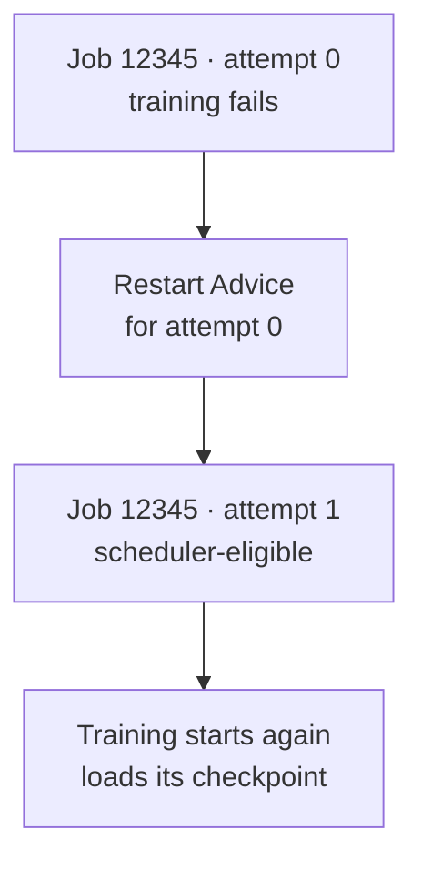

# Jobs, attempts, and workflows

An overnight training run is still one experiment after a failure, even if its
training script has to start several times. As a user, you want to know whether
that experiment is making progress. To recover it safely, NVIDIA Recovery also
needs to know exactly which execution failed and which execution is running now.

That is why the API separates **workflows**, which group related work, from
**Jobs**, which record individual execution attempts. Recovery adds a new
attempt to the history; it does not erase the failed one.

This guide is for job authors and operators. No running service is required;
familiarity with submitting a scheduler job is enough. It explains how to follow
one training run through a restart and what recovery does—and does not—prove.

## A workflow groups related execution

A workflow is the shared identity you use to follow a run. A simple workflow
might contain only a training job and its retries. A larger one might group
data preparation, training, and evaluation jobs. Giving them an explicit
workflow ID such as `training-run` makes that relationship visible without
forcing you to infer it from job names.

Grouping and ordering are different concerns. Putting training and evaluation
in the same workflow does not make evaluation wait for training. That requires
an explicit dependency. Likewise, retrying training is another execution of
the same scheduler job, not another pipeline stage.

For configured DAG dependencies, a child is submitted held. Job Manager
evaluates its parent gates and publishes release Advice when they are
satisfied. When a parent receives `TERMINATED` Advice, Job Manager publishes
termination Advice for its held dependents. SAC must still reconcile those
decisions to cancel the jobs. See
[dependency gates](scheduler-integration.md#dependency-gates-and-the-watchdog)
for the execution boundary.

For Slurm, the recovery comment can supply `workflow_id`. SAC otherwise uses
`workflow_name`, then the job name, then the scheduler job ID. “Workload” is a
useful name for your overall computation, not another generic API resource you
must create before submitting a job.

## A job in the API is one attempt

Suppose Slurm job `12345` is training your model. Its first execution is attempt
`0`. After a failure and requeue, Slurm keeps job ID `12345` but advances the
attempt index to `1`. In NVIDIA Recovery, these are **two Job records**, one
for each execution. There is no separate logical `Job` resource above them.

This distinction matters when information arrives late. A failure report or a
recovery decision for attempt `0` must not be mistaken for a problem with the
new execution. Keeping the old attempt also lets an operator ask what failed,
what decision followed, and what happened next.

## Follow the identities through a restart

The Advice stays attached to the failed **source attempt**, `0`. SAC may still
use it while observing **successor attempt** `1`: setting placement constraints
and releasing that successor can be part of finishing the restart. That does
not change the Advice's target.

If attempt `1` later fails, its recovery requires Advice for attempt `1`. A
delayed restart decision for attempt `0` must never control attempt `2`. The
attempt boundary keeps recovery decisions tied to the incident that prompted
them, instead of becoming an open-ended instruction to restart a job forever.

## Read state as evidence

Three different milestones matter to a training run:

1. **Scheduler recovery converged.** The successor is unheld with the required
   placement constraints. It is eligible to run, but may still be waiting for
   resources.
2. **Training resumed from a checkpoint.** The application started and loaded
   saved progress. NVIDIA Recovery does not create checkpoints or choose how
   the training code restores them.
3. **Training completed.** The application produced its expected result. A
   successful restart alone says nothing about this final outcome.

Job state is the scheduler adapter's observation of an execution. Advice is
the desired recovery outcome, and its reconciliation status records whether
that outcome was observed. A successful release command is not by itself
proof of convergence; a later scheduler observation must confirm it.

Your job must save checkpoints to storage that survives a failed execution and
load them on startup. Without that application support, a restart can rerun
the script but cannot restore lost training progress. The
[workload-user guide](../users/running-jobs.md) covers these responsibilities.

## Find a recovery in the API

The identities below connect this mental model to API responses:

| Field | Example | What it identifies |
| --- | --- | --- |
| `jobId` | `12345` | The scheduler job, shared across its requeues. |
| `attemptIndex` | `0`, then `1` | One execution of that scheduler job. |
| `heimdallJobId` | A UUID for each attempt | NVIDIA Recovery's stable identity for that exact execution. |
| `workflowId` | `training-run` | The group of related jobs and attempts. |

These are Gateway HTTP JSON names; protobuf uses `job_id`, `attempt_index`,
`heimdall_job_id`, and `workflow_id`. The compatibility name `heimdall_job_id`
remains part of the contract. When a publisher supplies no UUID, the job ID and
attempt index determine the default stable identity.

`GET /v1/jobs/by-scheduler-id/12345` returns attempt history, not necessarily
one Job. Match an Advice object's `jobId` and `attemptIndex` to its source
attempt when reading `GET /v1/advice`. Follow pagination without changing the
query filters mid-traversal.

Use `GET /v1/workflows` to list workflows or
`GET /v1/workflows:lookup?workflowId=training-run` to look up an opaque workflow
ID, with proper query encoding. The [Gateway API guide](../public-api/api-gateway.md)
covers authentication and exact-attempt lookups.

Next, read [Advice](advice.md): why recovery is recorded as a desired outcome
instead of a one-time scheduler command.
