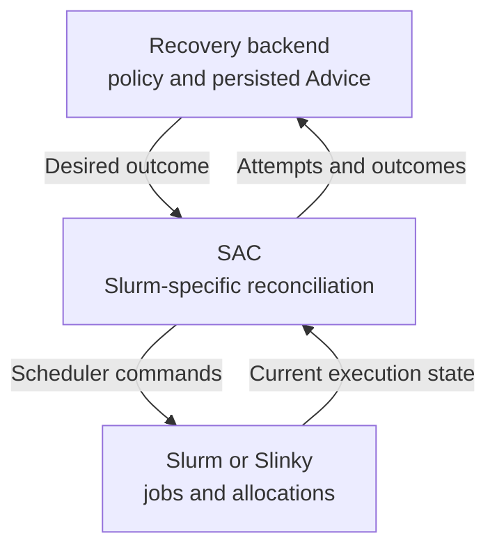

# Scheduler integration

“Restart this failed attempt without using that node” describes a recovery
outcome. It does not say how a scheduler should achieve it. A Slurm restart
needs different operations from another execution system, and only the
scheduler can tell whether the job is still held, has started again, or has
already moved beyond the failed attempt.

NVIDIA Recovery keeps these concerns separate: **the backend decides what
should happen; the adapter determines how to do it and verifies what happened.**
That boundary is why Job Manager publishes Advice instead of calling `scontrol`.

This guide is for operators and adapter developers familiar with
[Advice](advice.md). No running cluster is required. It explains the ownership
boundary, the shipped Slurm integration, and what portability does—and does
not—mean today.

## The shipped adapter

The Slurm Advisor Controller (SAC) integrates with Slurm and with Slurm running
on Kubernetes through Slinky. Both use the same scheduling boundary: Slurm owns
allocations, execution state, and the commands that change them.

The shared API describes jobs and recovery outcomes without requiring Slurm
commands. This makes other adapters architecturally possible; it does not mean
they are implemented. **Slurm and Slinky are the shipped integrations.** Running
the backend on Kubernetes does not provide a Kubernetes-native workload
controller, and Advice is not a Kubernetes CRD.

## Discover, publish, reconcile

Follow the same failed training job, `12345`, through the boundary:

1. **Observe the execution.** SAC discovers jobs from Slurm and publishes
   attempt state through API Gateway to Job Manager. For an eligible failed
   job, SAC can requeue it into hold before Advice exists, preserving it while
   the recovery decision is made.
2. **Read the decision.** Job Manager persists restart Advice for source
   attempt `0`, after evaluating recovery policy and available evidence.
3. **Translate intent into actions.** SAC checks current Slurm state and its
   action permissions, requeues and holds if needed, applies required placement
   constraints, and releases the successor.
4. **Verify the result.** On a later observation, SAC sees successor attempt
   `1` unheld with the required constraints and reports convergence.

SAC repeats this comparison on each reconciliation tick. It reads `squeue` and
targeted `sacct` records, joins observations and Advice by job ID and attempt,
and skips steps already satisfied. If the process stops after updating
constraints but before release, a subsequent tick can continue from fresh state.
Job Manager is also consulted once at startup to recover relevant attempts.

This is why the adapter needs observations as well as commands: a response from
`scontrol` cannot prove that the whole restart succeeded. It is also why the
backend does not duplicate Slurm's state machine from stored observations.

## Operating modes and action authorization

A deployment needs to distinguish watching a job from being permitted to change
it. SAC supports three effective modes:

| Mode | Behavior |
| --- | --- |
| `ignore` | Do not publish or plan recovery for the job. |
| `observe` | Publish state and evaluate recovery without changing Slurm. |
| `act` | Perform eligible recovery actions after all checks pass. |

A valid `APS` or compatibility `HEIMDALL` job comment participates in mode
selection. The independent operator setting
`SLURM_ADVISOR_ACKNOWLEDGE_SCHEDULER_ACTIONS` is the action ceiling: without it,
even a job requesting `act` resolves to `observe`. Missing or malformed comments
never authorize action.

SAC also checks environment admission, scheduler ownership, partition,
recovery policy, and exact-attempt applicability. An item appearing in the
active Advice feed is work to evaluate, not permission to mutate a scheduler.
Observe mode may still report an outcome established by fresh state, even
though that controller issued no command. See the
[mode resolution table](../architecture/slurm-advisor-controller.md#resolve-per-job-operating-mode)
for exact defaults and precedence.

## Placement changes and workload termination

If the decision excludes `gpu-001`, SAC changes the job's placement constraints.
It does not repair or globally drain that node. Hardware maintenance remains an
operator responsibility, and a restart need not exclude a node when evidence
and policy do not justify it.

Termination means canceling one exact attempt, unless it is already final.
Release means making one exact attempt scheduler-eligible. Neither may be
silently applied to a newer execution that shares the same scheduler job ID.
Checkpoint creation and restoration stay with the training application, not
the adapter.

## Dependency gates and the watchdog

The same separation applies before a pipeline stage can start. Job Manager
evaluates explicit dependencies and publishes `RELEASED` Advice for a held
child once its gates are satisfied. SAC carries out the release. If a parent
is finally terminated, Job Manager instead publishes termination Advice for
its held descendants; it still does not call Slurm directly.

A separate watchdog protects eligible recovery holds from lasting indefinitely.
It observes Slurm directly and can release them after a configured timeout
without backend Advice. It must not bypass an initial dependency gate: a DAG
child's held attempt `0` is never watchdog-released. DAG attempts `1` and later,
and managed non-DAG jobs at any attempt, can be eligible.

The watchdog has its own action mode and acknowledgement, and its timer is
process-local. It is not an extension of the job's SAC mode; an eligible hold
can time out even if an operator placed it manually. SAC's early hold path is
not a separate backend-outage recovery guarantee. Consult the
[watchdog rules](../architecture/slurm-advisor-controller.md#watchdog-release-behavior)
before setting release policy.

## Implementing an adapter

A new scheduler integration has to close the same loop, not just translate
three enum values into commands. It must publish stable attempt identities and
observed state, carry recovery policy and routing metadata, accept only Advice
it owns, perform repeatable scheduler actions, and report outcomes from fresh
observations. Scheduler-specific permissions and stale-attempt protection
remain its responsibility.

The [Gateway contract](../public-api/api-gateway.md) defines the messages and
transport. The [SAC architecture](../architecture/slurm-advisor-controller.md)
documents the reference implementation and its detailed safety rules. To see
the shipped integration recover a real test allocation, continue with
[Getting started](../getting-started.md).
