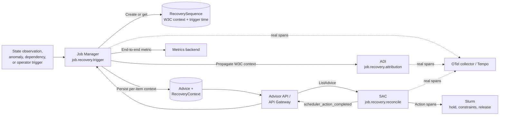
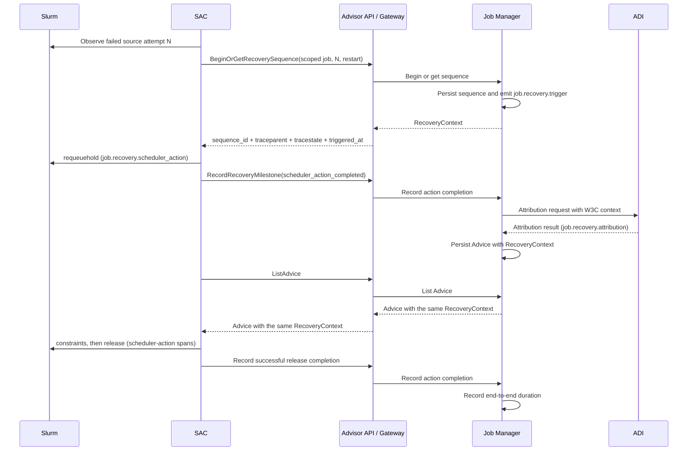
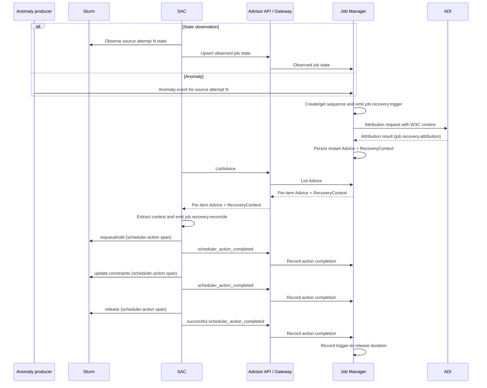

# ADR 0013: Correlate Recovery With Durable Trace Context

Status: accepted

Date: 2026-08-12

Discussion: [PR #7](https://github.com/NVIDIA/NVIDIA-Recovery/pull/7)

> **Implementation note (2026-10-08):** Persistence, backend-only sequence creation/read-only lookup, milestone validation, Advice/attribution span and audit correlation, and shared controller observations/reporting are implemented under [ADR 0048](0048-start-recovery-traces-in-backend-and-share-observations.md); UI correlation remains pending in a later layer of the [implementation stack](../architecture/recovery-observability-revision.md#changes-to-the-implementation-stack).

[ADR 0048](0048-start-recovery-traces-in-backend-and-share-observations.md)
supersedes this ADR's SAC-initiated sequence creation and direct-path tracing
requirements. The remaining correlation, propagation, and completion contracts
remain in force.

[ADR 0045](0045-require-advice-before-slurm-requeue.md) supersedes the direct
recovery compatibility-first implementation ordering below. Removal does not
require completing the obsolete direct-path sequence-creation integration;
the Advice tracing contract remains in force.

Related:
[ADR 0005](0005-require-causal-evidence-in-slurm-recovery-e2e-tests.md)
requires exact-attempt and source-specific evidence for recovery claims,
[ADR 0007](0007-resolve-dag-release-through-advice-state.md) defines exact-attempt
DAG release through Advice, and
[ADR 0009](0009-derive-watchdog-release-from-slurm-state.md) preserves
level-triggered watchdog behavior from fresh Slurm state, and
[ADR 0012](0012-standardize-global-otlp-collector-configuration.md) establishes
the shared deployment contract for OTLP exporter configuration.

## Context

NVIDIA Recovery inherited an anomaly-oriented tracing model. A Watcher or Job
Manager detection span creates a trace, RabbitMQ carries its W3C `traceparent`,
and anomaly-handling services create downstream spans in that trace. The tuple
of job ID, attempt index, and anomaly UUID has consequently served as the
recovery correlation key.

The Advisor architecture invalidates the assumption that every recovery stage
is caused by one anomaly message:

- the Slurm Advisor Controller (SAC) can currently call
  `reconcileFailedJobs` and issue `requeuehold` from observed Slurm state before
  actionable Advice exists
- Job Manager can request attribution independently of the RabbitMQ anomaly
  chain
- node constraints and desired state are durable Advice reconciled by polling,
  not event-bus commands
- `ListAdvice` returns items from unrelated recoveries, so one RPC trace context
  cannot represent every item
- SAC is written in Go while the existing shared tracing helpers are Python and
  RabbitMQ-specific

An anomaly UUID remains useful evidence, but state-triggered recovery and DAG
release may not have one. Requiring it would omit valid paths from end-to-end
measurements.

SAC is level-triggered and crash-safe. It may consider the same Advice in many
polling cycles and must reconstruct decisions from durable Advice and fresh
Slurm state. A live span object or process-local trace map cannot own recovery
identity.

The direct failed-state action also creates a product ownership issue: SAC can
mutate Slurm without first observing backend intent. The intended architecture
will move that decision behind Advice so Job Manager is the single intent
arbiter. Tracing can either accommodate the current split path first or begin
after that convergence.

This ADR concerns recovery correlation and latency. It does not remove the
later state-confirmation and retry behavior established by ADR 0007 and ADR
0009.

## Overview

At a high level, this design replaces anomaly identity as the required tracing
anchor with a durable recovery sequence owned by Job Manager. A trigger can be
a job-state observation, an anomaly, a dependency change, or an operator action.
Job Manager creates or finds the sequence, starts its trace, and puts the
sequence's W3C trace context on each resulting Advice item. SAC continues that
trace when it reconciles the Advice and invokes Slurm.

The end-to-end interval begins at the recorded trigger time and ends when the
successful `scontrol release` returns. That is the instant NVIDIA Recovery has
made the target attempt schedulable. A later Slurm observation remains useful
as a state-check span, but is outside the primary recovery duration.



The logical recovery identity and OpenTelemetry identity are related but not
interchangeable:

- the scoped job identity and operation kind idempotently locate a
  `RecoverySequence`
- `recovery.sequence.id` lets operators find the same recovery across durable
  records, logs, spans, and API calls
- `traceparent` and optional `tracestate` make independently emitted Python and
  Go spans members of the same OpenTelemetry trace
- an anomaly UUID is retained when present, but it is optional evidence rather
  than part of the required identity

### Example: state-driven direct action in the initial rollout

The initial tracing implementation supports the current direct
`reconcileFailedJobs` action. SAC may act before actionable Advice or a final
Job Manager state is observable, so it obtains the sequence context before that
direct action and later rejoins the same sequence when Advice becomes available.



The ordered effects and span ownership are:

| Order | Event | Real span and owner | Durable effect |
| --- | --- | --- | --- |
| 1 | SAC observes failed attempt `N` | The poll may have its own SAC span, but it does not own the recovery trace. | None yet. |
| 2 | SAC calls `BeginOrGetRecoverySequence` before direct action | Job Manager emits `job.recovery.trigger`. | Job Manager atomically creates or returns the sequence even if Advice does not yet exist. |
| 3 | SAC executes `requeuehold` | SAC emits `job.recovery.scheduler_action` under the returned context. | SAC reports `scheduler_action_completed`; the held target is not yet recovered. |
| 4 | Job Manager performs attribution and writes restart Advice | ADI emits `job.recovery.attribution`; Job Manager emits `job.recovery.advice`. | Advice stores the same per-item `RecoveryContext`. |
| 5 | SAC reconciles the Advice and releases the target | SAC emits `job.recovery.reconcile` and one span per scheduler command. | The successful release completion is persisted and completes recovery latency. |

The initial compatibility route therefore needs a public sequence-creation
operation and storage that can exist before fully materialized Advice. The call
provides correlation only; it must not become authorization for the direct
scheduler action.

### Example: Advice-driven recovery after future convergence

After the split decision-making architecture is separately converged, both state
and anomaly triggers can meet in Job Manager before any scheduler action. A
state-driven recovery then means Job Manager derives the trigger from fresh job
state received through the production API. An anomaly-driven recovery reaches
Job Manager through its existing event path. From sequence creation onward,
both use the same Advice-driven flow. This future simplification does not change
the recovery identity, propagation, span, or completion contracts in this ADR.



| Order | Event | Real span and owner | Durable effect |
| --- | --- | --- | --- |
| 1 | Job Manager accepts a state or anomaly trigger | Job Manager emits `job.recovery.trigger`; an incoming producer span may be linked. | Create or get one sequence for the scoped source attempt and operation. |
| 2 | Job Manager requests attribution | ADI emits `job.recovery.attribution` using request W3C headers. | Attribution output contributes to Advice; no separate tracing milestone is required. |
| 3 | Job Manager creates or updates Advice | Job Manager emits `job.recovery.advice`. | Advice stores its own `RecoveryContext`. |
| 4 | SAC polls and reconciles an Advice item | SAC emits `job.recovery.reconcile` under that item's context. | No live span object is stored in SAC. |
| 5 | SAC performs hold, constraint, and release commands | SAC emits a distinct `job.recovery.scheduler_action` for every attempt or retry. | Each returned action is reported as `scheduler_action_completed`. |
| 6 | The final release succeeds | The successful release span ends at command return. | Job Manager records the end-to-end metric from persisted trigger and reported completion timestamps. |
| 7 | A later poll confirms scheduler state | SAC may emit `job.recovery.state_check`. | Reliability state changes continue normally; primary latency is not extended. |

### Durable data and observability products

The design deliberately separates application durability from telemetry
retention:

| Data | Owner and location | Durability | How it is exposed and used |
| --- | --- | --- | --- |
| `RecoverySequence` | Job Manager recovery-sequence repository | Durable application state | Idempotently correlates a scoped job attempt and operation; supplies canonical W3C context and trigger time. |
| `RecoveryContext` | Public Advisor schema, persisted with each Advice | Durable for the life of the Advice | Returned per item by `ListAdvice`; SAC extracts it to continue the correct trace even when one response contains unrelated recoveries. |
| `scheduler_action_completed` | Reported through `RecordRecoveryMilestone` and stored by Job Manager | Durable application milestone | Deduplicates reports, preserves action outcome and completion time, and identifies the successful release used for end-to-end duration. |
| Real operation spans | Emitted by Job Manager, ADI, and SAC through OTLP to the configured trace backend | Telemetry retention, not reconciliation state | Tempo/Grafana show event order, retries, outcomes, and stage durations within one trace. |
| Metrics | Collector-derived span metrics plus Job Manager's trigger-to-release observation | Monitoring-system retention | Dashboards and alerts aggregate stage and end-to-end latency without using high-cardinality IDs as labels. |
| Anomaly UUID | Optional sequence evidence and span attribute | Durable only when supplied by the trigger path | Supports anomaly-oriented lookup without excluding state-driven or DAG-release traces. |

No persisted trace field authorizes, blocks, or changes scheduler behavior. The
durable context lets a later poll or restarted process emit correctly correlated
spans; it is not controller state.

## Implementation Order Decision

Two implementation routes preserve the final tracing contract:

| Route | Order | Advantages | Disadvantages |
| --- | --- | --- | --- |
| Split-architecture compatibility first | Instrument `reconcileFailedJobs`, then converge it to Advice later | Existing behavior gains visibility sooner; tracing does not depend on resolving the nuanced state-versus-anomaly decision ownership; both paths can be compared during a later convergence rollout. | Requires a public sequence-creation call from SAC and context recovery before Advice exists; preserves the current split decision-making architecture and adds compatibility logic that may later be retired. |
| Advice convergence first | Move state-based intent behind Advice, then add tracing | Job Manager creates every sequence; intent and context travel together; one production path and ownership model; less compatibility code. | Blocks observability on a larger behavioral change with scheduler-safety, attribution-ordering, Advice-merge, and stale-Advice nuances; likely delays tracing substantially and couples two independently reviewable changes. |

This ADR selects split-architecture compatibility first. Converging all recovery
decisions behind Advice remains the intended direction, but it is a substantial
behavioral and scheduler-safety change whose timing and unresolved merge
semantics should not block observability parity.

1. add `RecoverySequence` persistence that can exist before actionable Advice
2. expose `BeginOrGetRecoverySequence` and let SAC call it before the direct
   `reconcileFailedJobs` action
3. carry the returned context through the direct action, Job Manager
   attribution, and later per-Advice `RecoveryContext`
4. add Python and Go spans and W3C propagation for both branches
5. add `scheduler_action_completed`, reconcile outcomes, and Tempo/Grafana
   queries
6. retire or adapt anomaly-only dashboards after production-interface parity
7. converge the state-based decision behind Advice in a separate change, then
   remove compatibility machinery only after behavioral parity is established

The compatibility call is correlation only. Failure to obtain or report trace
context must be observable but must not authorize, block, or repeat the current
direct scheduler action. Job Manager later uses the same natural recovery key
when it processes an anomaly, attribution, or Advice, so both halves converge on
one sequence and trace even before their decision ownership converges.

## Decision

### Use a durable recovery sequence distinct from anomaly identity

Job Manager will own one durable `RecoverySequence` for each recoverable
operation. Its natural identity includes at least:

```text
scheduler scope
cluster or environment scope
job ID
source attempt index
operation kind
```

Operation kind distinguishes restart recovery from, for example, an initial
DAG release for the same attempt. Each record receives a random
`recovery.sequence.id`. The natural identity locates or idempotently creates the
record; it is not converted into an OpenTelemetry trace ID.

The sequence stores:

```text
recovery.sequence.id
traceparent
tracestate, when present
trigger type
trigger identifier, when present
trigger observed timestamp
operation kind
status
```

`anomaly.id` is optional trigger evidence, not required sequence identity.

When Job Manager begins a sequence, it creates and ends a real
`job.recovery.trigger` span. It uses the trustworthy trigger observation time
when available and persists that span's W3C context as the canonical parent for
later work. Incoming anomaly-detection, job-observation, or API spans may be
linked to this trigger instead of allowing a race between producers to choose
the canonical trace.

Stored trace context is correlation data. It does not authorize a scheduler
action or become reconciliation state.

### Carry per-item recovery context in Advice

The scheduler-neutral Advisor API will define an explicit `RecoveryContext` and
carry it on each Advice item. The initial conceptual shape is:

```proto
message RecoveryContext {
  string sequence_id = 1;
  string traceparent = 2;
  optional string tracestate = 3;
  google.protobuf.Timestamp triggered_at = 4;
  RecoveryOperation operation = 5;
}
```

Advice will contain an optional `recovery_context` field for compatibility with
older Advice. This is a first-class Advisor field rather than scheduler
metadata: the context is scheduler-neutral and each item in one `ListAdvice`
response can carry a different value.

Job Manager generates and persists the context. SAC accepts it only from the
trusted Advisor API, validates its W3C representation, and does not extract
context from scheduler comments or arbitrary scheduler metadata. The initial
contract does not propagate arbitrary baggage.

### Emit real operation spans across Python and Go

Python services and SAC will share stable operation (i.e., span) names:

```text
job.recovery.trigger
job.recovery.attribution
job.recovery.advice
job.recovery.reconcile
job.recovery.scheduler_action
job.recovery.state_check
```

Identifiers and outcomes are attributes:

```text
recovery.sequence.id
recovery.operation = restart | terminate | dag_release
recovery.trigger.type = anomaly | job_state | dependency | operator
recovery.slo.eligible = true | false
recovery.outcome = applied | skipped | failed | planned
recovery.terminal = true | false
job.id
job.attempt.source
job.attempt.target
advice.id
advice.state
advice.skip.reason, when skipped
scheduler.system = slurm
scheduler.action = slurm.requeue_hold | slurm.update_constraints | slurm.release | slurm.cancel
scheduler.action.outcome = planned | success | error | already_satisfied
anomaly.id, when present
```

SAC extracts an Advice item's context and uses it as the remote parent of the
per-item reconcile span. Scheduler command spans are its children. A polling
loop may link to recovery work but is not its parent because one loop can
process many sequences.

For direct point-to-point work such as Job Manager's attribution request to
ADI, the caller restores the sequence context and injects standard W3C headers
on that request. The receiver extracts those headers before creating its
operation span. The per-Advice schema field is needed specifically where one
transport response contains work from multiple sequences.

Repeated reconciliation and command retries create separate real spans in the
same trace. Go passes trace state through `context.Context`; Python uses normal
OpenTelemetry contexts. Neither stores live trace objects as controller state.
Stage latency is the duration of the corresponding real operation span. Retry
spans retain their own outcome and retry identity rather than being collapsed
into one synthetic stage.

The Python tracing library will gain generic W3C carrier injection and
extraction while retaining RabbitMQ as one carrier. SAC will independently
initialize the OpenTelemetry Go provider, W3C propagation, OTLP export, and
graceful shutdown.

### End spans promptly and classify logical recovery outcomes

OpenTelemetry ends spans, not a distributed trace as a separate object. The
`job.recovery.trigger` span ends after Job Manager creates or gets the sequence;
every attribution, Advice, reconcile, state-check, and scheduler-action span
ends when that real operation returns. Later operations restore the persisted
W3C context and add more ended spans to the same trace. No span is held open
while waiting for Advice, a polling cycle, or a retry.

The real `job.recovery.reconcile` span records the outcome of each Advice
application attempt. The span that establishes the logical terminal outcome
sets `recovery.terminal=true`; earlier or retryable attempts set it to `false`:

| Situation | Span status and attributes | Logical result |
| --- | --- | --- |
| Final scheduler release succeeds | Release action has `scheduler.action.outcome=success`; reconcile has `recovery.outcome=applied` and `recovery.terminal=true`. | Recovery is applied and enters the command-attributed latency population. |
| Advice is already satisfied | Reconcile has `recovery.outcome=skipped`, `advice.skip.reason=already_satisfied`, and `recovery.terminal=true`; status remains unset because this is not an instrumentation error. | Sequence is terminal, but no precise command-attributed completion time is invented and it is excluded from the completed-latency population. |
| Advice is permanently inapplicable, stale, expired, or unsupported | Reconcile has `recovery.outcome=skipped`, a stable `advice.skip.reason`, and `recovery.terminal=true`; status remains unset. | Sequence is terminal and excluded from the recovery SLO population. |
| Advice is deferred because a later snapshot or the owning controller may apply it | Reconcile has `recovery.outcome=skipped`, a stable reason, and `recovery.terminal=false`. | Sequence remains active; a later reconcile span may establish the terminal outcome. |
| Scheduler action fails but is retryable | Action and reconcile spans use OpenTelemetry `ERROR`; reconcile has `recovery.outcome=failed` and `recovery.terminal=false`. | The attempt ends, but the level-triggered recovery remains active and later retries create new spans in the same trace. |
| Policy declares a failure non-retryable or abandons an expired sequence | The real reconcile or expiry operation uses `ERROR`, `recovery.outcome=failed`, and `recovery.terminal=true`. | Sequence is terminally failed and excluded from completed latency. |
| Observe mode plans but does not execute an action | Reconcile has `recovery.outcome=planned`, `recovery.terminal=false`, and `recovery.slo.eligible=false`. | The attempt ends and is visible, but the sequence is not reported as applied or terminal because a later act-mode reconciliation may execute it. |

Skip reasons must have an explicit terminal classification. Conditions such as
missing fresh scheduler state, a future attempt, or ownership by a different
controller cannot be declared terminal merely because one SAC poll skipped
them. A failed scheduler command is likewise non-terminal while the controller
will retry it. The current controller has no retry-exhaustion policy, so tracing
does not manufacture a terminal failure after an arbitrary number of errors.

Tempo and Grafana query the explicit outcome rather than inferring it from trace
age, root-span duration, or the absence of a release span. Example TraceQL
selectors are:

Applied recoveries:

```traceql
{ span:name = "job.recovery.reconcile" && span.recovery.terminal = true && span.recovery.outcome = "applied" }
```

Terminal skips, grouped or inspected by `span.advice.skip.reason`:

```traceql
{ span:name = "job.recovery.reconcile" && span.recovery.terminal = true && span.recovery.outcome = "skipped" }
```

Terminal failures:

```traceql
{ span:name = "job.recovery.reconcile" && span.recovery.terminal = true && span.recovery.outcome = "failed" && span:status = error }
```

Traces containing retryable failed attempts:

```traceql
{ span:name = "job.recovery.reconcile" && span.recovery.terminal = false && span.recovery.outcome = "failed" && span:status = error }
```

A trace can contain both retryable error spans and a later terminal applied
span; this correctly shows that recovery eventually succeeded after retries.
Dashboards count completed recovery only from terminal `applied` spans and keep
terminal `skipped`, terminal `failed`, `planned`, and non-terminal attempts in
separate populations. A process crash can leave a sequence with no terminal
span at all. Tempo cannot safely infer current sequence state merely from the
absence of a span, so coverage for such orphaned sequences comes from an
active-sequence age metric derived from durable `RecoverySequence` records. A
future reaper may emit a real expiry operation span if terminal abandonment is
introduced; it must not fabricate an end-to-end summary span.

These queries use current TraceQL scoped attributes and the `span:status`
intrinsic described by the
[Grafana Tempo TraceQL documentation](https://grafana.com/docs/tempo/latest/traceql/construct-traceql-queries/).
The span-lifecycle and status behavior follows the
[OpenTelemetry trace specification](https://github.com/open-telemetry/opentelemetry-specification/blob/main/specification/trace/api.md).

### Complete restart latency at successful scheduler release

For `RESTARTED` Advice on source attempt `N`, measured recovery completes when
the final successful Slurm command makes target attempt `N+1` schedulable:

```text
scontrol requeuehold     not complete; the target remains held
update node constraints  not complete; the target remains held
scontrol release         complete when the command succeeds
```

The end of the successful release `job.recovery.scheduler_action` span is the
completion timestamp:

```text
end-to-end recovery latency =
    successful release span end - recovery trigger span start
```

This measures NVIDIA Recovery's control-plane latency. It excludes time waiting
for resources or priority after the attempt is schedulable.

A later poll may verify that Slurm reports the attempt unheld or running. That
check remains important for level-triggered reliability and may emit
`job.recovery.state_check`, but it does not add a polling interval to primary
recovery latency. ADR 0009's watchdog requirement to confirm release and retry
when the job remains held is unchanged.

A failed release does not complete recovery; a later successful retry does.
Observe mode emits planned actions but is excluded from completed recovery.
When SAC finds Advice already satisfied and performs no command, it reports
`already_satisfied` but does not invent a precise command-attributed completion
timestamp from poll time.

### Persist only scheduler action completion initially

The initial durable milestone surface contains only
`scheduler_action_completed`. SAC records it when an attempted scheduler action
returns, with the action type, operation kind, completion timestamp, outcome,
explicit sequence-completion intent, and idempotency key. The key distinguishes
retries while suppressing duplicate reporting of the same occurrence. SAC marks
only a successful final release milestone as completing a restart sequence.

Job Manager exposes the production `RecordRecoveryMilestone` operation and
writes through its recovery-sequence repository. SAC never writes Job Manager's
database directly. Reporting failure does not block or authorize scheduler
action, and repeating milestone reporting must not repeat the Slurm command.
The initial implementation reports coverage gaps through metrics and logs. A
durable SAC outbox may be added later if crash-proof milestone delivery becomes
a requirement.

On receipt, Job Manager validates the milestone against its sequence and uses
the reported scheduler-action completion timestamp together with the persisted
trigger timestamp to record end-to-end duration. It does not use API receipt
time, which would add network and retry delay. Hosts participating in this
measurement must maintain bounded clock skew; deployment monitoring must expose
time-synchronization failures because cross-service span timestamps share the
same requirement.

There is no separate durable action-start milestone because the real command
span contains both timestamps. Job Manager does not emit a span impersonating
work performed by SAC.

The initial design does not add a retrospective `job.recovery` summary span.
Tempo and Grafana use the real trigger, attribution, Advice, reconcile, and
action spans. A summary span may be considered later if querying real spans is
insufficient.

### 2026-08-20 contract amendment: keep scheduler semantics in adapters

Human review of the initial implementation clarified three cross-component
contracts without changing this ADR's recovery flow or latency boundary:

- Scheduler-specific action wire values are namespaced by their adapter. The
  initial values are `slurm.requeue_hold`, `slurm.update_constraints`,
  `slurm.release`, and `slurm.cancel`; later adapters add their own namespace
  instead of reusing ambiguous global action names.
- `RecordRecoveryMilestone` requires an explicit `completes_sequence` boolean.
  The scheduler adapter sets it from workflow semantics after the command
  result is known. Job Manager persists the first accepted completion and never
  derives terminal behavior from operation, action, or outcome fields.
- The recovery-sequence natural-key uniqueness constraint is the concurrency
  authority. The first committed candidate wins as one complete immutable row;
  losing writers return that canonical row without merging later trigger or
  trace fields into it.

These clarifications keep the shared API and storage scheduler-neutral while
preserving the accepted rule that a failed release cannot complete restart
latency and a successful final Slurm release can.

### Trace DAG release but exclude it from the recovery SLO

`ADVICE_STATE_RELEASED` uses the same context propagation, reconcile spans, and
scheduler-action spans, classified as:

```text
recovery.operation = dag_release
recovery.slo.eligible = false
```

Its successful release remains observable but does not enter the failed-job
restart latency population.

### Use NVIDIA Recovery public naming

Spans use domain-oriented `job.recovery.*` names. Metrics use the public product
prefix, for example:

```text
nvidia_recovery_sequences_total
nvidia_recovery_reconcile_outcomes_total
nvidia_recovery_scheduler_actions_total
nvidia_recovery_scheduler_action_duration_seconds
nvidia_recovery_end_to_end_duration_seconds
nvidia_recovery_active_sequence_age_seconds
```

Resources use names such as `nvidia-recovery-slurm-advisor-controller`,
`nvidia-recovery-job-manager`, and `nvidia-recovery-attribution-adapter`. New
telemetry names do not use the internal `heimdall` prefix.

Collector span metrics provide stage and scheduler-action distributions. Job
Manager records the end-to-end distribution when it accepts a successful final
release milestone, using the two persisted event timestamps defined above.
High-cardinality values such as job ID, Advice ID, anomaly ID, and sequence ID
remain trace attributes and are not metric labels.

If one trace is required for every recovery, recovery roots are sampled at 100
percent and downstream services honor the parent decision. Any collector
tail-sampling window must be long enough for a complete recovery.

## Consequences

The trace topology follows product ownership: Job Manager owns intent and
correlation, Advice carries durable per-item context, and scheduler adapters
own scheduler-operation spans.

Recoveries can be found by sequence ID, scoped job identity, or optional anomaly
evidence. Anomaly- and state-driven restarts share one latency definition, and
one Advice poll can continue multiple traces correctly.

The Advisor schema, Job Manager persistence, API Gateway translation, Python
services, Go controller, deployment, and dashboards require coordinated
changes and generated-contract validation.

Supporting the split decision-making architecture adds a public sequence-
creation call and context-recovery behavior before Advice exists. It delivers
tracing parity without waiting for a larger scheduler-behavior change and does
not endorse the split as the final ownership model. Later Advice convergence
can remove this compatibility machinery without changing recovery identity or
telemetry contracts. The completion definition avoids adding polling delay
while retaining state checks for diagnosis.

Persisting only action completion keeps the audit surface small. Earlier stage
timing depends on exported real spans. Lossless durable timing for every stage
would require a future decision.

Trace context cannot affect scheduler safety. Missing, invalid, unsampled, or
unreportable context must not authorize, block, or alter reconciliation; metrics
and logs must expose such coverage gaps.

Production-interface tests must establish:

- atomic creation or retrieval under concurrent triggers
- distinct restart and DAG-release sequences for the same source attempt
- W3C propagation from Job Manager through one Advice item to SAC
- Python and Go spans sharing one trace across Advice polling
- distinct retry spans without duplicate completion milestones
- successful release span end defining restart completion
- terminal applied, skipped, and failed outcomes, plus non-terminal planned
  attempts, remaining separately queryable in Tempo
- retryable action errors remaining non-terminal until later success or an
  explicit terminal policy decision
- later state checks not extending primary duration
- exclusion of planned, failed, and already-satisfied cases from completed
  command-attributed latency
- DAG release visibility with SLO exclusion
- invalid or absent context degrading observability without changing action

Scheduler action, public schema, and recovery persistence retain their existing
human-review requirements.

## Alternatives Rejected

### Converge recovery decisions behind Advice before tracing

This route would first remove SAC's direct `reconcileFailedJobs` decision and
make Job Manager the sole recovery-intent owner. It produces the simplest final
trace propagation because sequence context and intent always travel together on
Advice.

It is not selected as the implementation prerequisite because convergence has
independent scheduler-safety and product semantics: state and anomaly signals
must be merged deterministically, actionable Advice must not be published
before required attribution, and SAC must not act on a superseded Advice
snapshot. Resolving and validating those nuances is likely to take longer than
the tracing work. Blocking observability on convergence would couple two
independently reviewable changes and leave the current production path without
end-to-end traces in the meantime.

Advice convergence remains a future architecture improvement. When it lands,
it reuses the same natural sequence key and per-Advice context, then retires
`BeginOrGetRecoverySequence` calls from SAC after behavior and telemetry parity
are established.

### Derive trace ID from job ID and attempt index

This conflates business and telemetry identity, omits scheduler scope and
operation kind, risks collision across clusters, and bypasses SDK sampling. A
random sequence ID and SDK-generated W3C context provide lookup without
fabricated trace identifiers.

### Continue requiring anomaly UUID

State recovery and DAG release may have no anomaly. Requiring one preserves an
incomplete SLO. Anomaly identity remains optional evidence.

### Propagate only at the ListAdvice RPC level

One response contains unrelated recoveries. One RPC context would incorrectly
join them into the polling trace. Context therefore travels per Advice item.

### End recovery at a later confirmation poll

The first poll that observes attempt `N+1` unheld or running occurs after the
job is already schedulable and adds up to one polling interval of observation
delay. State checks remain separately observable.

### Add a retrospective summary span initially

A synthetic span could simplify dashboards but duplicates real timing and adds
timestamp and ownership rules. The first implementation queries real spans and
leaves a summary as a future option.

### Keep one live span for the entire recovery

Recovery crosses services, storage, polls, retries, and restarts. A live object
is not crash-safe. Persisted W3C context with short real spans preserves
correlation without making process memory part of recovery identity.
