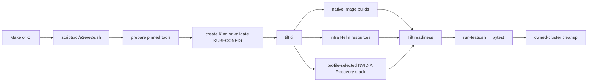

# CI Script Notes

This directory contains repository CI helpers. The full Slurm/Slinky e2e
harness under `scripts/ci/e2e/` uses Tilt to build images, install the selected
environment, and wait for Kubernetes readiness. The pytest scenario runner
remains independent of Tilt so developers can run it against any ready
compatible cluster.

## Command Boundaries

Use Make for local convenience:

```bash
make dev       # persistent Tilt development session and UI
make dev-ci    # headless environment convergence only
make e2e       # disposable environment plus the full scenario suite
make e2e-up    # the full suite, preserving the owned Kind cluster afterward
```

GitHub call the CI script directly:

```bash
bash scripts/ci/e2e/e2e.sh
```

Both entrypoints execute the same lifecycle:



Tilt v0.37.5 is pinned in `env.sh`. `prepare.sh` uses a compatible binary from
`PATH` when present; otherwise it downloads the official macOS, GNU Linux, or
Alpine Linux archive, verifies it against the release `checksums.txt`, and
caches it under:

```text
${XDG_CACHE_HOME:-$HOME/.cache}/heimdall-e2e/tools
```

## Source and Helm release commands

The [release procedure](../../RELEASE.md) owns versioning, dependency/license
review and publication approval. Build and inspect exact committed assets locally:

```bash
python3 -m unittest discover -s scripts/release -p 'test_*.py'
python3 scripts/release/package.py package v0.2.2 /tmp/release-first
python3 scripts/release/package.py package v0.2.2 /tmp/release-second
diff -r /tmp/release-first /tmp/release-second
python3 scripts/release/package.py verify /tmp/release-first
```

Use empty output directories, Python 3.12+ and Helm 3.17.3. Packaging uses only
committed source, locked public chart dependencies and local lint/render checks.
It does not execute live recovery or private-provider qualification. Secret
scanning/removal is explicitly skipped. These checks are not runtime evidence.

`helm-release.sh package <version>` remains the nightly chart helper. It requires
`Chart.lock`, uses `helm dependency build`, checks the packaged archive and writes
it plus `version`, `app-version` and effective `Chart.yaml` under `dist/helm`.
`helm-release.sh publish [--skip-existing] <registry> <oci-repository> <username>`
uses `HELM_REGISTRY_PASSWORD` and pushes that existing archive; it never rebuilds.
`HELM_OUTPUT_DIR` selects another output directory. Tagged publication refuses
existing versions; nightly retries may skip them.

GitHub's protected-tag workflow passes the exact qualified source/chart artifacts
to the `helm-release` environment. The composite action uses `package: "false"`
for this path and publishes the downloaded chart. GitHub Release assets contain
both archives, versioned notes, identity metadata and checksums. Tagged publication
also requires the existing public E2E job; this implementation does not trigger it.
No executable or container images are published. The existing nightly path retains its E2E
prerequisite and is not a tagged source release. Environment reviewers, protected
tags and anonymous distribution must be verified separately by maintainers.

`DEV_CI_TIMEOUT` controls only the `tilt ci` convergence phase and defaults to
`90m`. Scenario-specific timeouts remain owned by the pytest fixtures and the
individual scenarios.

## Running Scenarios Against A Ready Cluster

The scenario runner remains usable without starting Tilt. Export the kubeconfig
and any suite inputs, then invoke its `run_tests` function:

```bash
export DEPLOY_KIND_CLUSTER=
export KUBECONFIG=/tmp/kind-heimdall-e2e-dev.kubeconfig
export E2E_STACK_NAMESPACE=slurm
bash -c 'source scripts/ci/e2e/run-tests.sh; run_tests'
```

Pytest writes one testcase per scenario to
`reports/e2e/<profile>-<backend>/job_state/junit.xml`. `E2E_XUNIT_PATH` overrides
the report path when a caller needs a separate local artifact.

The focused native recovery case uses this minimum environment contract:

| Variable | Focused-run value |
| --- | --- |
| `KUBECONFIG` | Required path to the ready cluster's kubeconfig. |
| `E2E_STACK_NAMESPACE` | Set to `slurm` to enable the pre-suite readiness gate; empty skips only that gate. Only `run_tests` runs the gate; a direct `pytest` run skips it, so run `uv run --package recovery-libs --extra e2e e2e-stack-gate` first if you want it. `run_tests` then checks the log collectors, shared log permissions, and log backend selection; run `PYTHONPATH=tests uv run --group e2e python -m e2e_harness.conformance` to check them yourself. |
| `E2E_PROFILE` | Defaults to `wfc`. |
| `SLURM_NS` | Defaults to `slurm`. |
| `VALIDATE_TIMEOUT` | Defaults to 420 seconds; the example narrows it to 300. |

Run one scenario directly when iterating on a focused behavior:

```bash
export E2E_STACK_NAMESPACE=slurm
VALIDATE_TIMEOUT=300 uv run --locked --group e2e pytest -ra --capture=tee-sys \
  tests/e2e/scenarios/10-simple-segfault/test_simple_segfault_recovery.py::test_simple_segfault_recovery
```

The native fault-injection case uses the same table plus this input:

| Variable | Focused-run value |
| --- | --- |
| `E2E_LOG_BACKEND` | `loki` (default) or `victorialogs`; must match the deployed store. |
| `LOKI_URL` / `VICTORIALOGS_URL` | Selected local query connection: `http://loki-gateway.monitoring.svc.cluster.local` or `http://victorialogs.monitoring.svc.cluster.local:9428`. |

```bash
export KUBECONFIG=/tmp/kind-heimdall-e2e-dev.kubeconfig
export E2E_STACK_NAMESPACE=slurm
export LOKI_URL=http://loki-gateway.monitoring.svc.cluster.local
VALIDATE_TIMEOUT=420 \
  uv run --locked --group e2e pytest -ra --capture=tee-sys \
  tests/e2e/scenarios/40-fault-inject-1/test_fault_inject_1_recovery.py::test_fault_injection_recovery
```

Staged scenarios cancel only the jobs they submitted. Tests that submit through
`SlurmClient.managed_job` also require the whole Slurm queue to settle empty, so
run them on a dedicated e2e queue; unrelated jobs make their cleanup time out
and are never canceled.

## Full-Suite Inputs

Boolean toggles use the empty/non-empty convention: an empty value is off and
any non-empty value is on.

| Variable | Effect |
| --- | --- |
| `E2E_PROFILE` | Selects `advisor-observe` or `advisor-act`. |
| `DEPLOY_KIND_CLUSTER` | Non-empty creates an owned Kind cluster; empty requires a caller-supplied `KUBECONFIG`. |
| `CLUSTER_NAME` | Names an owned Kind cluster and its standalone kubeconfig. |
| `KIND_CONFIG` | Supplies an optional Kind configuration file. |
| `DEPLOY_INFRA` | Controls Tilt's shared infrastructure resources; CI sets it to `1` for full-suite jobs. |
| `DEPLOY_STACK` | Controls Tilt's NVIDIA Recovery stack resources; CI sets it to `1` for full-suite jobs. |
| `RUN_TESTS` | Controls scenario execution after Tilt succeeds; defaults on in `env.sh`. |
| `KEEP_CLUSTER` | Leaves an owned cluster running after success or failure. |
| `DEV_CI_TIMEOUT` | Bounds Tilt environment convergence; default `90m`. |
| `E2E_SCENARIOS` | Space-separated exact scenario directory names; unknown names fail pytest collection. |
| `E2E_LOG_BACKEND` | Selects `loki` (default) or `victorialogs` for deployment, collection, and evidence. |
| `LOKI_URL` / `E2E_LOKI_URL` | Local Loki connection; an explicit empty value disables Loki-dependent scenarios. |
| `VICTORIALOGS_URL` / `E2E_VICTORIALOGS_URL` | Local VictoriaLogs connection, defaulting to `http://victorialogs.monitoring.svc.cluster.local:9428` when selected and infrastructure is deployed. |

The harness never deletes a caller-owned cluster selected with
`DEPLOY_KIND_CLUSTER=`. For an owned cluster, its EXIT trap deletes Kind and the
standalone kubeconfig unless `KEEP_CLUSTER` is set.

## Focused Legacy Helpers

The primary full suite does not invoke the repository image builder,
`load-images.sh`, or `provision.sh`; Tilt owns those responsibilities, and the
former Bash stack `install.sh` has been removed. The focused Advisor chart smoke
invokes `scripts/build-images.sh` for production images, then uses the shared
load, provision, and cluster modules. `LOAD_IMAGES` and `E2E_IMAGES_TO_LOAD`
remain advanced inputs for those focused helpers, not the normal full-suite
interface.

## Backend qualification

Both CI providers run standard and attribution lanes with `E2E_LOG_BACKEND`
set to each supported backend. Reports use `<profile>-<backend>` so artifacts
cannot overwrite another variant. Attribution retains its existing source and
credential requirements and writes to `reports/e2e-attribution/`.

`02-log-ingestion` verifies deployed reader/writer selection and writes plain
and JSON messages through Slurm output and node syslog. It checks exact message
bodies, current timestamps, source labels, and system/workload separation.
Fault recovery cases still require the complete causal evidence chain.

```bash
E2E_LOG_BACKEND=victorialogs DEPLOY_INFRA=1 DEPLOY_STACK=1 make e2e
E2E_LOG_BACKEND=victorialogs E2E_ATTRIBUTION_MODE=available \
  DEPLOY_INFRA=1 DEPLOY_STACK=1 \
  E2E_SCENARIOS='02-log-ingestion 42-fault-inject-xid-79 40-fault-inject-1 41-fault-inject-2 20-segfault-template' \
  make e2e
```

Use a fresh disposable cluster for each variant. Backend URL overrides identify
local Kubernetes Services for service-proxy evidence; they are not a remote
backend configuration interface. See the [operator guide](../../docs/ops/configure-log-query-backends.md#local-tilt-and-e2e).
